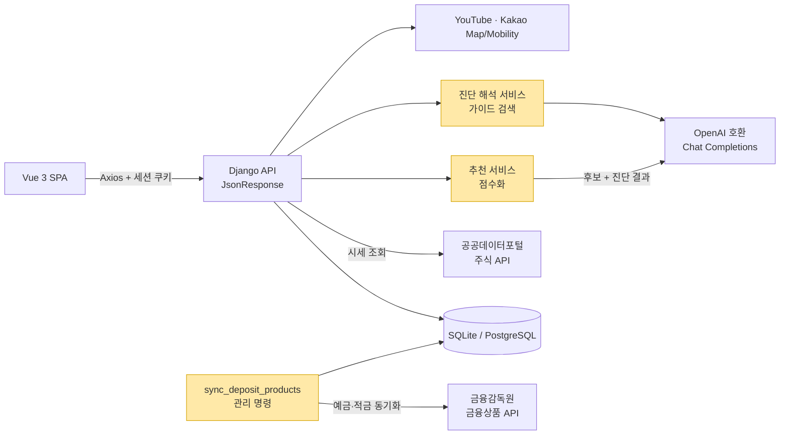
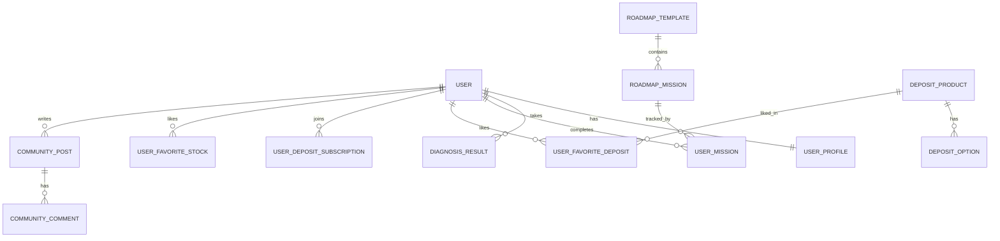
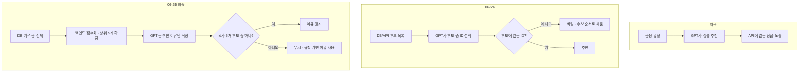

# FinPick · 금융진단 및 금융상품 추천 서비스

> 사회초년생이 자신의 금융 상태를 진단하고, 실제 예·적금 상품과 단계별 성장 로드맵을 추천받는 서비스.
> 저는 2인 팀에서 **풀스택 개발**과 **AI 추천 로직 개선**을 맡았습니다. GPT가 금융상품 API에 없는 상품을 추천하는 문제를 겪은 뒤, **실제 조회된 상품만 후보로 두고 GPT는 그 안에서만 동작하도록** 추천 구조를 바꿨습니다.

## 기본 정보

| 항목 | 내용 |
| --- | --- |
| 기간 | 2026.06.22 ~ 2026.06.26 (기획 회의 05.08 ~ 06.12, 초기 뼈대 커밋 06.11 ~ 06.12) |
| 형태 | SSAFY 15기 1학기 관통 프로젝트 · 2인 팀 |
| 역할 | 풀스택 개발 · AI 추천 로직 — Django API, Vue 화면, 금융상품 데이터 동기화, GPT 추천·설명 흐름 |
| 주요 기술 | Python · Django 5 · Vue 3(Vite, Vue Router, Pinia, Axios) · OpenAI Python SDK(OpenAI 호환 게이트웨이) · SQLite / PostgreSQL |
| 외부 API | 금융감독원 금융상품통합비교공시 · 공공데이터포털 주식시세 · YouTube Data · Kakao Map / Kakao Mobility · logo.dev |
| 성과 | GPT 추천 결과를 API 조회 상품으로 한정해 존재하지 않는 상품 추천을 구조적으로 차단 |
| 링크 | [GitHub](https://github.com/jisudori0402/FinPick) · 시연 영상: 추가 예정 |

---

## 1. 문제 정의

첫 월급을 받은 사회초년생은 적금, 청약, 투자, 카드 같은 선택지는 많은데 **무엇부터 해야 하는지** 판단하기 어렵습니다.
기존 금융 앱은 상품을 나열하는 데 집중하고, 광고성 추천이 섞여 있어 믿기도 어렵습니다.

FinPick은 다음 순서로 이 문제를 풀었습니다.

1. 6문항 진단으로 금융 준비도 점수와 금융 유형(6종)을 계산합니다.
2. 유형에 맞는 5단계 로드맵과 미션을 제시합니다.
3. **실제 공시된 예·적금 상품 중에서** 사용자에게 맞는 상품을 추천하고, 왜 맞는지 쉬운 문장으로 설명합니다.

금융 서비스에서 가장 먼저 지켜야 할 조건은 **추천한 상품이 실제로 존재해야 한다**는 것이었습니다. 이 조건이 아래 트러블슈팅의 출발점입니다.

## 2. 주요 기능

- **금융 진단**: 소득·소비 성향·금융 목표·투자 성향·자산·대출 6문항 → 준비도(100점 만점), 유형 판정, 강점·보완점
- **AI 진단 해석**: 진단 결과와 금융 가이드를 함께 넣어 GPT가 강점 2개, 보완점 2개, 오늘의 금융 메시지를 생성 (실패하면 규칙 기반 문구로 대체)
- **금융 성장 로드맵**: 유형별 5레벨 미션, 완료 토글과 완료 시각 저장
- **예·적금**: 금융감독원 API 동기화, 목록·검색·상세(기간별 금리 옵션), 관심 상품, 가입 관심 목록
- **AI 상품 추천**: 백엔드 점수화로 상위 5개 선정 + GPT 추천 이유
- **주식·현물**: 국내 주식 시세 조회·상세·관심 종목, 금/은 시세 시각화
- **은행 찾기**: Kakao Map 지도 검색과 Kakao Mobility 경로 안내
- **커뮤니티**: 게시글·댓글 CRUD, YouTube 금융 영상 검색과 인기 검색어

## 3. 아키텍처

노란색이 이 글의 중심인 데이터 동기화와 AI 추천 영역입니다.

**설계 원칙**

- **상품 데이터는 DB에 먼저 저장합니다.** 요청마다 금융감독원 API를 부르지 않고, 관리 명령으로 예금·적금과 금리 옵션을 동기화합니다. `(상품유형, 금융회사코드, 상품코드)` 조합에 unique 제약을 둬서 다시 돌려도 중복이 생기지 않습니다(update_or_create).
- **GPT 응답은 항상 JSON**(`response_format=json_object`)으로 받고, 파싱에 실패하거나 설정값이 없으면 **규칙 기반 결과로 대체**합니다. AI가 실패해도 화면이 비지 않게 하기 위해서입니다.
- 인증은 Django 세션 방식입니다. 배포 환경에서는 SameSite=None·Secure 쿠키, CORS·CSRF 허용 출처를 환경변수로 분리했습니다.

### 데이터 모델 (요약)

이 밖에 `FinancialGuide`(프롬프트 참고 자료), `DailyFinancialTip`(오늘의 메시지 캐시), `AiProductRecommendation`(유형별 일 단위 추천 캐시), `SearchKeywordTrend` 등 모델 18개, 마이그레이션 19개입니다.

## 4. 기술 스택과 선택 이유

| 기술 | 사용 위치 | 선택 이유 |
| --- | --- | --- |
| Django + JsonResponse | API 서버 | 관통 프로젝트 교육 범위(Django/Vue). DRF 없이 함수형 뷰로 빠르게 구현 `확인 필요: DRF를 쓰지 않은 이유` |
| Vue 3 + Vite | 프론트엔드 | 06-22에는 Django 템플릿으로 기능을 먼저 확인하고, 06-23에 Vue SPA로 옮김 (화면 15개) |
| 금융감독원 금융상품 API | 예·적금 데이터 | 실제 공시된 상품과 기간별 금리를 얻을 수 있는 공식 출처. 추천 후보의 근거가 됨 |
| OpenAI 호환 Chat Completions | 진단 해석, 추천 이유 | 낮은 temperature(0.2~0.35) + JSON 출력으로 응답 형식을 고정 |
| 키워드 기반 가이드 검색 | 프롬프트 보강 | 벡터 DB 없이 `FinancialGuide`를 영역 키워드로 찾아 프롬프트에 넣음. 5일 일정에서 근거 자료를 붙이는 가장 단순한 방법 |
| Render + gunicorn + whitenoise + dj-database-url | 배포 준비 | `render.yaml` 하나로 백엔드·정적 프론트·PostgreSQL을 구성 `확인 필요: 실제 배포 완료 여부` |

## 5. 설계 결정과 트레이드오프

### 결정 1. 추천의 "선택"은 백엔드가, "설명"은 GPT가

- **상황:** 처음에는 GPT에게 금융 유형을 주고 예·적금 5개, 주식 5개를 고르게 했습니다.
- **문제:** GPT가 금융상품 API에서 조회되지 않는 상품을 추천했습니다. (→ 6. 트러블슈팅 문제 1)
- **선택:** 단계적으로 GPT의 역할을 줄였습니다.
  1. 후보 목록을 프롬프트에 넣고, GPT가 고른 ID 중 **후보에 없는 것은 버림** (06-24)
  2. GPT에게는 상품명이 아니라 **검색 조건만** 만들게 하고, 백엔드가 후보와 매칭 (06-25, 최종 코드에는 호출되지 않는 코드로 남음)
  3. **백엔드 점수화로 상위 5개를 확정**하고, GPT는 각 상품의 **추천 이유만** 작성 (06-25, 최종)
- **감수한 비용:** GPT의 "판단"을 쓰지 않으니 추천 품질이 점수 공식에 그대로 좌우됩니다. 점수 공식은 직관으로 정한 가중치라 검증되지 않았습니다. (→ 9. 한계)

### 결정 2. 점수 공식을 설명 가능한 규칙으로

최종 추천은 상품마다 아래 항목을 더한 점수로 정렬합니다. 항목마다 "왜 이 점수가 붙었는지"를 문장(`score_reasons`)으로 같이 저장합니다.

| 조건 | 가산점 | 함께 저장하는 이유 문구(요지) |
| --- | --- | --- |
| 최고 우대금리 | 금리 × 8 | — |
| 예금/적금 유형 | +20 | 구조가 단순한 안정형 상품 |
| 진단 투자 점수 < 70 | +18 | 투자 경험이 적은 사용자의 시작점 |
| 진단 안정성 점수 < 70 | +18 | 원금 손실 가능성이 낮음 |
| 월 저축 가능액(소득−지출) ≤ 가입 한도 | +10 | 저축 가능 금액 안에서 검토 가능 |
| 가입 기간 6~12개월 (24개월 이하 +6) | +12 | 단기 목표 자금에 적합 |
| 금리 3% 이상 | +8 | 후보 안에서 금리 경쟁력 |
| 준비도 60점 미만 | +10 | 이해하기 쉬운 상품 우선 |

- GPT가 응답하지 않아도 **이 이유 문구만으로 추천 카드가 완성**됩니다. GPT 설명은 있으면 덧붙이는 보조 정보가 됐습니다.
- 사용자 정보로 붙는 가산점(투자·안정성·준비도)은 한 사용자 안에서는 모든 상품에 똑같이 붙습니다. 실제 순위를 가르는 건 금리·기간·한도라는 점을 나중에 확인했습니다. (→ 9. 한계)

### 결정 3. 실패하면 규칙 기반으로 내려가기

- 진단 해석은 GPT 실패 시 점수 구간별 규칙 문구(예: 소비 점수 70 미만이면 고정비·구독 점검 제안)로 대체합니다.
- GPT 결과도 그대로 쓰지 않습니다. 공백을 정리하고, 중복을 제거하고, 개수가 모자라면 규칙 문구로 채워 **항상 강점 2개·보완점 2개**를 맞춥니다.
- 프롬프트 제약: 과장된 투자 권유 금지, 원금 손실 상품 단정 추천 금지, 없는 정보 생성 금지, 45자 안팎 문장.

## 6. 트러블슈팅

### 문제 1. GPT가 금융상품 API에 없는 상품을 추천함 (환각)

- **문제:** GPT에게 유형별 상품 추천을 맡기자, 금융상품 API에서 조회되지 않는 상품이 추천 결과에 나왔습니다. 금융 서비스에서 존재하지 않는 상품을 안내하면 사용자의 판단을 왜곡합니다.
- **원인:** GPT는 "그럴듯한 상품명"을 만들어낼 수 있고, 생성 결과를 실제 데이터와 대조하는 단계가 없었습니다. `확인 필요: 처음 발견했을 때의 구체적인 사례(어떤 상품명이 나왔는지)와, 그때 후보 목록을 프롬프트에 넣지 않았는지 여부 — Git에는 환각이 발생한 버전이 남아 있지 않음`
- **해결 1 (06-24, 후보 제한 + 화이트리스트):**
  - DB에 동기화된 예·적금 중 금리 상위 30개, 주식 API 시가총액 상위 40개를 **후보**로 만들어 JSON으로 프롬프트에 넣었습니다. 프롬프트에 "반드시 제공한 후보 안에서만 고를 것"을 명시했습니다.
  - GPT가 돌려준 ID·종목코드는 **후보 목록에 있는 것만 남기고** 중복을 제거했습니다. 모자라면 후보 순서대로 채워 항상 5개를 맞췄습니다.
  - GPT 호출이 실패하면 후보 상위 항목으로 대체하고, 결과는 `(날짜, 금융 유형)` 단위로 캐싱했습니다.
- **해결 2 (06-25, 역할 분리):**
  - 상품 선택을 GPT에서 완전히 빼고, 진단 결과 기반 **점수화로 상위 5개를 확정**했습니다(결정 2).
  - GPT에는 확정된 5개만 넘기고 "이미 선정됐으니 다른 상품을 고르지 말고 이유만 쓸 것"을 지시했습니다.
  - 응답의 `id`가 **후보 5개 중 하나일 때만** 이유를 붙입니다. GPT가 다른 ID를 만들어도 화면에 나올 경로가 없습니다.
- **결과:** 화면에 나오는 추천 상품은 항상 DB에 저장된 실제 공시 상품입니다. GPT는 선택하지 않고 설명만 하므로, 생성 결과가 틀려도 영향은 "설명 문장"으로 한정됩니다. `확인 필요: 개선 전후 환각 발생 빈도 같은 수치 기록 여부`

### 문제 2. 추천 개수 변경 후 이전 캐시가 그대로 노출됨

- **문제:** 추천 결과는 `(날짜, 금융 유형)` 단위로 캐싱되는데, 추천 개수를 3개에서 5개로 늘리면(06-24) 그 전에 만들어진 3개짜리 캐시가 그대로 반환될 수 있었습니다.
- **해결:** 개수를 상수(`AI_RECOMMENDATION_COUNT`)로 빼고, 캐시된 결과가 **이 개수보다 적으면 캐시를 쓰지 않고 다시 생성**하도록 조건을 추가했습니다.

### 문제 3. 주식 데이터가 중복으로 표시됨

- **문제:** 주식 시세 API 응답에 같은 종목의 여러 기준일 데이터가 섞여 목록에 중복이 생겼습니다.
- **해결:** 종목 코드별로 **가장 최근 기준일 데이터만 남기는** 중복 제거 단계를 넣었습니다. 키가 없거나 API 호출이 실패하면 미리 정의한 대체 종목 목록을 보여줍니다.
- 06-23 "주식 검색 창 오류 수정" 커밋도 있습니다. `확인 필요: 이 커밋에서 고친 구체적인 증상`

### 문제 4. 배포 환경에서 로그인 세션이 유지되지 않을 위험

- **문제:** 프론트(정적 사이트)와 백엔드가 다른 도메인으로 분리되면 세션 쿠키가 전달되지 않습니다.
- **해결 (06-26):** Axios 요청은 `withCredentials`로 세션 쿠키를 보내고, 운영 모드에서는 세션·CSRF 쿠키를 `SameSite=None; Secure`로 바꿨습니다. CORS·CSRF 허용 출처, DB 주소, API 키를 모두 환경변수로 옮기고 `.env.example`과 배포 가이드를 남겼습니다. 프론트의 하드코딩된 백엔드 주소도 `VITE_API_BASE_URL`로 바꿨습니다.

## 7. 내가 작업한 것

**백엔드 (Django)**

- 금융감독원 예·적금 동기화 관리 명령, 예·적금 목록·검색·상세·관심·가입 관심 API
- 금융 진단(점수 계산, 6유형 판정), 로드맵·미션 토글, 대시보드·프로필, 비밀번호 변경·재설정
- 주식 시세 조회·상세·관심 종목, 금/은 현물 시세, Kakao 지도·경로, YouTube 검색·인기 검색어, 커뮤니티 API

**AI 추천·해석**

- GPT 상품 추천 → 후보 제한 + 화이트리스트 → 점수화 + 이유 생성으로 이어지는 추천 구조 개선
- 진단 해석 서비스(`ai_services`): 약점·강점 영역 계산, 가이드 검색, 프롬프트 구성, JSON 파싱과 규칙 기반 대체
- 추천 서비스(`product_recommendation_service`): 상품 점수화와 이유 문구, GPT 이유 매핑

**프론트엔드 (Vue)**

- Django 템플릿 프로토타입 → Vue 3 SPA 전환, 라우트 가드, UI 전면 개편, 추천 상품 화면

**문서·배포**

- README, ERD 문서, Render 배포 설정(`render.yaml`)과 배포 가이드

**기여 지표 (git 기준)**

| 항목 | 값 |
| --- | --- |
| 전체 커밋 | 21개 (merge 없음, main 단일 브랜치) |
| 내 이메일로 된 커밋 | 20개 · 팀원 커밋 1개(스플래시 애니메이션) |
| 프로젝트 규모 | REST 엔드포인트 37개 · 모델 18개 · 마이그레이션 19개 · Vue 라우트 15개 |
| 테스트 | 자동화 테스트 없음 |

> 커밋은 대부분 제 이메일로 남아 있지만, 팀 README에는 팀원이 금융진단·로드맵·맞춤형 추천·외부 API 연동을 맡았다고 적혀 있습니다. 커밋 수만으로 담당 범위를 나눌 수 없어서 위 목록은 `확인 필요: 실제 분담(누가 어떤 기능을 구현했는지)`입니다.

## 8. 작업 타임라인

| 기간 | 작업 |
| --- | --- |
| 05.08 ~ 06.12 | 기획 회의 5회: 문제 정의, 페르소나, 진단 문항·점수 체계·6유형·로드맵 명세 |
| 06.11 ~ 06.12 | Django 초기 뼈대, 로그인 기본 진입 화면 |
| 06.22 | 진단·로드맵 모델, **예·적금 데이터 동기화**와 목록·검색, 지도 검색·경로 안내, 현물 시각화, 커뮤니티·관심 상품 모델 (Django 템플릿) |
| 06.23 | **Vue 3 SPA 전환**, 주식 검색 오류 수정, 홈 화면 수정, UI 전면 수정 |
| 06.24 | **AI 추천 기능**(후보 제한 + 화이트리스트 + 일 단위 캐시), 관심 주식, 오늘의 금융 메시지, 추천 3개 → 5개 |
| 06.25 | **AI 로직을 서비스 모듈로 분리**, 점수화 추천 + GPT 이유 생성, 가이드 검색, ERD·README, 비밀번호 재설정 |
| 06.26 | 아이콘 교체, **배포 준비**(환경변수 분리, PostgreSQL, Render 설정) |

## 9. 한계와 다음 개선

- **점수 공식이 검증되지 않았습니다.** 가중치는 직관으로 정했고, 사용자 진단으로 붙는 가산점은 한 사용자 안에서 모든 상품에 같아 순위에 영향을 주지 않습니다. 다음에는 상품 속성(유형·기간·우대조건)과 진단 결과를 교차하는 조건으로 바꾸고, 사람이 판단한 추천과 비교하고 싶습니다.
- **최종 구조에서 주식 추천이 빠졌습니다.** 점수화 추천은 예·적금만 대상이라 응답의 주식 목록이 비어 있습니다. 06-24 버전의 일 단위 캐시도 최종 경로에서는 쓰이지 않습니다.
- **사용하지 않는 코드가 남아 있습니다.** 첫 번째 추천 프롬프트는 같은 이름의 상수로 덮어써졌고, 조건 생성 방식 코드는 early return 뒤에 남아 실행되지 않습니다. OpenAI 클라이언트 생성 코드도 세 곳에 중복돼 있습니다.
- **"RAG"는 키워드 검색 수준입니다.** 시드 가이드 6개를 키워드로 찾아 프롬프트에 넣는 구조라, 근거 자료의 양과 검색 품질이 모두 제한적입니다.
- **요청마다 GPT를 두 번 호출합니다**(추천 이유 + 오늘의 메시지). 응답 지연과 비용을 측정하지 못했습니다.
- **기획 명세와 코드의 점수표가 다릅니다.** 예를 들어 소득 최저 구간이 명세는 4점, 코드는 8점입니다. 어느 쪽이 최종 합의인지 정리하지 못했습니다.
- **자동화 테스트가 없습니다.** 특히 "후보 밖 ID는 버린다"는 핵심 규칙은 단위 테스트로 고정해야 했습니다.

## 10. 배운 점

- **생성형 AI에게 맡길 일과 맡기면 안 되는 일을 나눠야 합니다.** "어떤 상품이 존재하는가"는 데이터의 영역이고, "왜 이 상품이 맞는가"는 언어의 영역입니다. 선택은 데이터와 규칙에, 설명은 GPT에 맡기니 환각이 생겨도 피해 범위가 문장으로 한정됐습니다.
- **프롬프트 지시만으로는 보장이 되지 않습니다.** "후보 안에서만 골라"라고 써도, 코드에서 후보 목록과 대조하는 단계가 있어야 실제로 지켜집니다.
- **AI 기능에는 항상 대체 경로가 필요합니다.** 키가 없거나 응답이 깨져도 규칙 기반 결과로 화면을 채우도록 해서, AI 호출 여부와 상관없이 서비스 흐름이 끊기지 않게 했습니다.
- **짧은 일정일수록 구조 변경 뒤 정리가 필요합니다.** 5일 동안 추천 방식을 세 번 바꾸면서 이전 방식의 코드가 남았습니다. 다음에는 방식을 바꿀 때 이전 코드를 지우고 커밋 단위를 나눠, 변화 과정이 기록에 보이게 하겠습니다.

## 11. 예상 면접 질문

Q. 환각 문제를 프롬프트로 해결하지 않고 구조를 바꾼 이유는 무엇인가요?

프롬프트에 "후보 안에서만 골라"라고 써도 GPT가 반드시 따른다는 보장이 없습니다. 그래서 먼저 GPT가 돌려준 ID를 후보 목록과 대조해 없는 것은 버리는 검증 단계를 넣었고, 그다음에는 상품 선택 자체를 백엔드 점수화로 옮겼습니다. 지금은 GPT가 다른 ID를 만들어도 화면에 표시될 경로가 없습니다. 지시가 아니라 데이터 흐름으로 막은 것입니다.

Q. GPT가 선택을 하지 않는다면 AI를 쓰는 의미가 있나요?

사회초년생에게는 "금리 3.5%, 12개월"보다 "지금 비상금을 모으는 단계라 원금 손실이 없는 12개월 적금이 맞다"는 설명이 더 필요했습니다. 진단 결과와 상품 정보를 연결해 쉬운 문장으로 풀어주는 일은 규칙으로 만들기 어렵고, GPT가 잘하는 영역입니다. 반대로 어떤 상품이 존재하는지는 GPT가 판단할 일이 아니라고 봤습니다.

Q. 점수화 기준은 어떻게 정했고, 맞다고 볼 수 있나요?

안정형 상품 선호, 투자 경험이 적은 사용자 보호, 6~12개월 단기 목표, 금리 경쟁력 같은 사회초년생 기준을 가중치로 옮겼습니다. 다만 검증된 값은 아닙니다. 다시 보니 사용자 진단에 따른 가산점은 한 사용자 안에서 모든 상품에 똑같이 붙어서 순위를 바꾸지 못했습니다. 개선한다면 진단 결과와 상품 속성을 교차하는 조건으로 바꾸고, 사람이 고른 추천과 비교하겠습니다.

Q. GPT 호출이 실패하면 사용자는 무엇을 보나요?

추천 상품 자체는 백엔드 점수화로 정해지므로 그대로 보입니다. 이유는 점수 계산 때 같이 만든 규칙 문구가 표시됩니다. 진단 해석도 점수 구간별 규칙 문구로 대체하고, GPT 응답이 와도 정리·중복 제거 후 개수가 모자라면 규칙 문구로 채웁니다. API 키가 없는 로컬 환경에서도 전체 흐름이 동작합니다.

Q. 상품 데이터를 왜 요청마다 API로 조회하지 않고 DB에 저장했나요?

외부 API 응답 시간과 장애에 추천 화면이 직접 영향을 받지 않게 하고, 상품마다 내부 ID를 부여해 관심 상품·가입 관심·추천 결과가 같은 ID를 참조하게 하려고 했습니다. 이 내부 ID가 GPT 응답을 후보와 대조하는 기준이 됐습니다. 동기화는 관리 명령으로 실행하고, 상품 코드 조합의 unique 제약으로 다시 돌려도 중복이 생기지 않습니다. 자동 주기 동기화는 구현하지 않았습니다.

Q. 5일이라는 짧은 기간에서 가장 아쉬운 점은 무엇인가요?

추천 방식을 세 번 바꾸면서 이전 방식의 코드가 정리되지 않고 남았고, 핵심 규칙인 "후보 밖 결과는 버린다"를 테스트로 고정하지 못했습니다. 기능을 붙이는 속도에 비해 정리와 검증이 늦었습니다. 다시 한다면 AI 결과를 검증하는 규칙부터 테스트로 만들고 시작하겠습니다. `확인 필요: 이후 프로젝트(와글와글·잎새로)의 검증 경험으로 연결할지`

---

> 작성 기준: 공개 GitHub 저장소의 코드와 커밋 기록, 기획·회의 노트를 바탕으로 정리했습니다. API 키, 서버 주소, 팀원 개인정보, 내부 문서 링크는 싣지 않았습니다.
