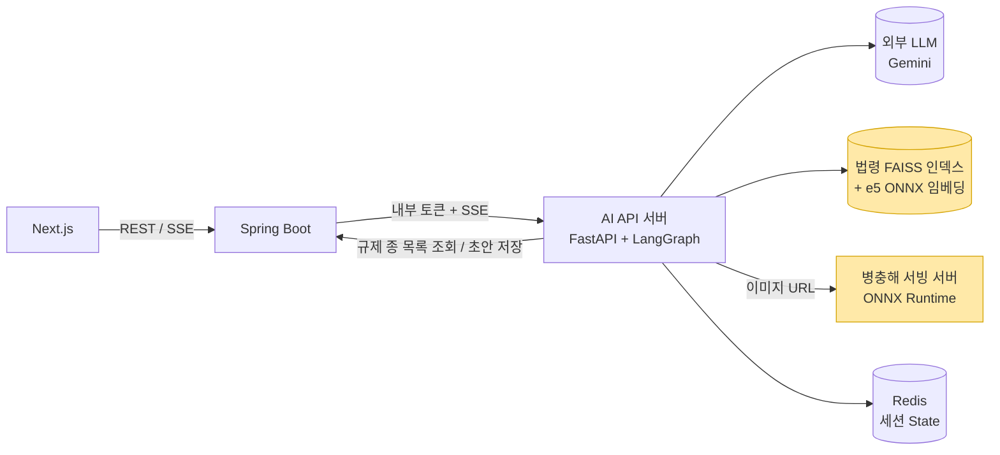
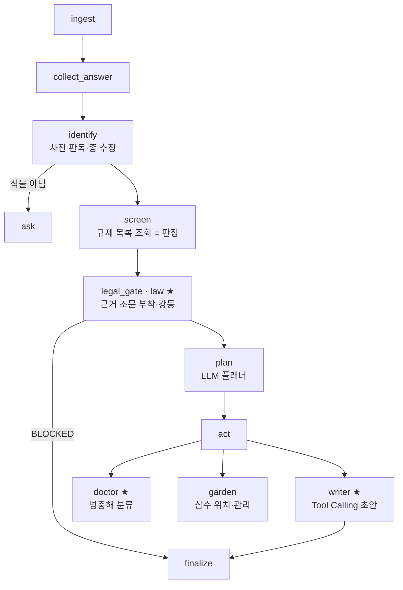

# 잎새로 · 반려식물 나눔 AI 플랫폼

> 반려식물을 나눌 때 필요한 병충해 확인, 법적 제한 확인, 나눔글 작성을 AI 대화로 돕는 플랫폼.
> 저는 6인 팀의 **AI 서버 개발자**로, 멀티에이전트의 서브에이전트 4종 중 **법률(law)·병충해 진단(doctor)·나눔글 작성(writer)** 3종을 맡았습니다.

## 기본 정보

| 항목 | 내용 |
| --- | --- |
| 기간 | 2026.08.17 ~ 2026.09.28 (저장소 커밋 2026.08.28 ~ 09.28) |
| 형태 | SSAFY 15기 2학기 특화 프로젝트 · 6인 팀 (FE 2 · BE 2 · AI 2 · 팀장은 Infra/FE 겸임) |
| 역할 | AI 서버 — 법률 RAG와 규제 판정 조립, 병충해 분류 모델 학습·서빙, Tool Calling 나눔글 작성 |
| 주요 기술 (내 담당) | Python 3.12 · FastAPI · FAISS · sentence-transformers(multilingual-e5) · ONNX Runtime · PyTorch(EfficientNet-B0 전이학습) · LangChain Tool Calling · Pydantic v2 · uv |
| 팀 전체 스택 | Next.js · Spring Boot · LangGraph · Redis · MySQL · Docker · k3s · GitLab CI · Prometheus/Grafana/Loki |
| 성과 | 근거 조문 4건 교정 · 병충해 모델 val 정확도 88.8%(임계값 통과분 95.5%) · ONNX FP32로 PyTorch 없이 CPU 추론 |
| 링크 | 코드 저장소는 SSAFY 내부 GitLab이라 비공개 · 시연 영상: 추가 예정 |

---

## 1. 문제 정의

식물 나눔은 중고 거래와 달리 **물건 자체가 위험할 수 있습니다.**

- **병충해**: 병든 개체를 나누면 받는 사람의 다른 식물까지 옮습니다. 나누는 사람도 자기 식물이 병들었는지 잘 모릅니다.
- **법적 제한**: 대마·양귀비 같은 마약류 원료식물, 가시박 같은 생태계교란 생물, CITES 등재 선인장처럼 **유통이나 양도가 제한되는 종**이 있습니다. 일반 사용자는 어떤 법의 몇 조에 걸리는지 알기 어렵습니다.
- **글쓰기 부담**: 종 이름, 상태, 나눔 형태(삽수·포기·씨앗), 관리법을 정리해 글을 쓰는 일이 번거롭습니다.

잎새로는 사용자가 사진과 말로 "이거 나눔할래요"라고 하면, AI가 식물을 판독하고 규제를 확인한 뒤 병충해·삽수 위치·관리 정보를 모아 **나눔글 초안까지** 만들어 줍니다.

AI 파트에서 가장 먼저 정한 원칙은 이것이었습니다.

> **확인하지 않은 것을 확인한 척 말하지 않는다.**
> "법적으로 문제없습니다", "병충해가 없습니다"를 믿고 나눈 사용자에게 문제가 생기면, 그건 서비스가 만든 피해입니다.

`확인 필요: 기획 단계의 사용자 조사·유사 서비스 분석 자료(팀 Notion 워크스페이스가 다음 프로젝트용으로 재구성되어 원본을 확인하지 못함)`

## 2. 주요 기능

**서비스 전체 (팀)**

- 나눔 게시판, 반려식물 테스트 기반 나눔 추천, 찜·DM 채팅, 반려식물 관리 기록
- **AI 나눔 도우미 채팅**: 사진 + 대화 → 식물 판독 → 규제 확인 → 병충해 진단·삽수 안내 → 나눔글 초안을 SSE로 스트리밍

**내 담당 (서브에이전트 3종)**

- **law**: 규제 판정에 **실제 법령 조문 근거**를 붙이고, 근거가 없으면 `UNVERIFIED`(확인 필요)로 강등
- **doctor**: 사진을 병충해 분류 서빙 서버에 보내 결과를 단정하지 않는 문장으로 변환
- **writer**: 모인 재료로 나눔글 본문을 쓰고, 필요하면 **법령 검색·병충해 분류 툴을 직접 호출**
- 법령 KB 오프라인 파이프라인(수집 → 조 단위 청킹 → 임베딩 → FAISS)
- 병충해 분류 모델 학습 파이프라인과 별도 서빙 서버

## 3. 아키텍처

노란색이 제가 처음부터 만든 구성요소이고, API 서버 안의 law·doctor·writer 서브에이전트도 제 담당입니다.

**설계 원칙**

- **프론트는 AI 서버를 직접 부르지 않습니다.** Spring이 인증과 공통 응답 래핑을 맡고, AI 서버는 내부 토큰이 있는 `/internal/` 경로만 엽니다.
- **규제 종 목록의 주인은 백엔드입니다.** AI는 목록을 받아 쓰기만 하고, 받지 못하면 최소 폴백 목록으로 버팁니다.
- **병충해 서빙은 별도 프로세스입니다.** 이미지 분류는 무겁고 LLM 호출과 성격이 달라 분리했습니다. 같은 uv workspace 안에서 `api`·`serving` 두 패키지로 나눴습니다.
- **SSE 이벤트 계약은 늘리지 않습니다.** 조문 원문, 참고 안내(advisories), 강등 전 판정은 State에만 두고, 이벤트에는 합의된 필드만 내보냅니다. 계약을 늘리면 프론트·백엔드와 다시 합의해야 하기 때문입니다.

### 한 턴의 흐름 (그래프는 팀원 설계, ★ 노드가 내 담당)

- 그래프·플래너·세션 State·이벤트 계약은 AI 팀원이 설계했습니다.
- **법률 게이트는 플래너가 건너뛸 수 없도록 코드로 강제**되어 있습니다. `BLOCKED`면 플래너에 도달하지 않고 끝납니다.

## 4. 기술 스택과 선택 이유

| 기술 | 사용 위치 | 선택 이유 |
| --- | --- | --- |
| 국가법령정보 OPEN API (`target=eflaw`) | 법령 수집 | `target=law`는 최근 **공포본**을 주는데, 식물방역법은 아직 시행 전인 개정판이었습니다. 시행일법령만 받아 효력 있는 조문만 인용 |
| FAISS `IndexFlatIP` | 조문 검색 | 조각 591개 규모라 완전탐색이 정확하고 빠름. HNSW·IVF 같은 근사 탐색은 이 규모에서 이득이 없음 |
| `dragonkue/multilingual-e5-small-ko` | 임베딩 | e5-small의 한국어 파인튜닝판(384차원). KURE-v1(1024차원)은 약 2.2GB라 서버에 올리지 않고 실험용으로만 비교 |
| ONNX Runtime (FP16 임베딩 / FP32 분류기) | 런타임 추론 | 서버에 PyTorch를 올리지 않기 위해. torch·transformers·sentence-transformers는 `build` 의존성 그룹으로 빼고 런타임에는 `onnxruntime`·`tokenizers`·`faiss-cpu`만 남김 |
| EfficientNet-B0 (ImageNet 사전학습, 백본 동결) | 병충해 분류 | 클래스당 학습 이미지가 44~61장뿐이라 전체 fine-tune 대신 분류기만 학습. CPU 추론을 고려한 경량 모델 |
| LangChain Tool Calling | writer | 초안에 필요한 법령·병충해 정보를 모델이 필요할 때만 가져오게 함 |
| Pydantic v2 (camelCase alias) | 서빙 API 스키마 | Spring·프론트와 같은 필드 관례. `verdict: OK / UNCERTAIN`으로 "판정 불가"를 표현 |

## 5. 설계 결정과 트레이드오프

### 결정 1. 규제 판정은 LLM이 하지 않는다 — 판정과 설명의 분리

- **상황:** "이 식물 나눔해도 되나요?"에 LLM이 직접 답하게 하면, 같은 종이 턴마다 다르게 판정될 수 있습니다. 차단해야 할 종이 한 번이라도 통과하면 사고입니다.
- **선택:** 역할을 세 겹으로 나눴습니다.
  1. **판정**: `screen`이 백엔드 규제 목록을 **딕셔너리 조회**해서 `PASS / CONDITIONAL / BLOCKED`를 정합니다. 결정적이고 재현됩니다.
  2. **근거**: law 에이전트(`verdict.py`)는 판정을 **다시 하지 않고**, 지목된 조문을 찾아 붙이고 사람 말로 옮깁니다.
  3. **설명**: LLM은 문장만 씁니다. 실패하면 템플릿으로 조립한 문장으로 되돌아갑니다.
- `screen`의 반환 구조를 아는 곳은 어댑터(`verdict_adapter.py`) 하나로 모았습니다. 규제 목록이 하드코딩에서 백엔드 API로 바뀔 때 어댑터만 고치면 되도록 하기 위해서입니다.
- **감수한 비용:** 목록에 없는 종은 `PASS`가 됩니다. 그래서 `PASS` 문구는 "법적으로 문제없습니다"가 아니라 **"확인된 목록에서는 해당 항목이 발견되지 않았습니다"**로 고정했습니다.

### 결정 2. 근거 조문이 없으면 막지 않고 '확인 필요'로 강등

- **상황:** 원래 요구사항은 "근거 조항이 없으면 답변 자체를 막는다"였습니다. 그대로 적용하면 `PASS`가 전부 막힙니다. `PASS`는 원래 조항이 없는 게 정상이기 때문입니다.
- **선택:** 제한 판정(`BLOCKED`·`CONDITIONAL`)에만 근거를 요구하고, 근거를 못 찾으면 **`UNVERIFIED`로 강등**한 뒤 원래 판정을 `degradedFrom`에 남겼습니다.
  - 근거 없이 "제한됩니다"라고 말하는 것이 이 계층에서 가장 위험한 출력이라고 봤습니다.
  - `UNVERIFIED` 문장에는 원래 판정을 꺼내지 않습니다. 근거가 없는 상태에서 원래 판정을 말하면 추측이 됩니다.
- **판정별 문구 규칙**

  | 판정 | 쓰는 표현 | 금지 표현 |
  | --- | --- | --- |
  | BLOCKED | 유통·재배가 제한됩니다 | 나눔이 불가능합니다 / 불법입니다 |
  | CONDITIONAL | 조건을 갖추면 가능합니다 + 체크리스트 | 그냥 됩니다 |
  | UNVERIFIED | 확인이 필요합니다 | 판정을 추측하는 모든 문장 |
  | PASS | 확인된 목록에서는 발견되지 않았습니다 | 법적으로 문제없습니다 |

- **감수한 비용:** 강등되면 규제 차단이 조용히 풀립니다. 그래서 Prometheus 지표 `ai_law_verdicts_total{degraded="true"}`를 두고, 이 값이 오르면 인덱스가 없거나 임베딩 설정이 어긋났다는 신호로 보도록 문서화했습니다.

### 결정 3. 조 번호를 알면 벡터 검색을 쓰지 않는다 — 정확 조회 우선

- **상황:** 규제 목록은 이미 `마약류 관리에 관한 법률 제3조`처럼 **조 번호를 가지고 있습니다.** 벡터 검색은 틀릴 수 있지만 조 번호 조회는 틀리지 않습니다.
- **선택:** 리트리버가 시작할 때 `(법령명, 조) → 조각 목록` 딕셔너리를 만들고 `get_article()`로 정확 조회합니다.
  - `제6조`와 `제6조의2`가 섞이지 않도록 **가지번호를 정규식의 별도 그룹**으로 잡았습니다.
  - 법령명은 정확 일치 → 포함 관계 → 약칭(`야생생물법`) 순으로 맞추고, **후보가 둘 이상이면 아무것도 돌려주지 않습니다.**
  - 정확 조회에 실패했을 때만 벡터 검색으로 퇴행하지만, **퇴행 결과는 근거로 승격하지 않고** 참고(advisory)로만 넘깁니다.
- **이 결정의 계기:** 규제 목록이 실존하지 않는 `야생생물법 제24조의2`를 가리키고 있었는데, 벡터 퇴행이 이를 `제24조(야생화된 동물의 관리)`로 메워 **가시박 규제 근거처럼** 내놓았습니다. 그건 근거가 아니라 오근거였습니다. (→ 6. 문제 1)

### 결정 4. 법령 조각은 조(條) 단위로, 길면 항 경계에서만

- 고정 길이로 자르면 인용문이 문장 중간에서 끊겨 근거로 쓸 수 없습니다. 법령은 조 단위로 의미가 닫히므로 **조 하나를 한 조각**으로 잡았습니다.
- 1,200자를 넘는 조는 **항 경계에서만** 쪼개고, 쪼갠 조각마다 `제6조(병해충위험분석)` 같은 헤더를 다시 붙였습니다. 조각이 단독으로 검색돼도 어느 조인지 보여야 인용이 성립합니다.
- 임베딩용 텍스트(`embed_text`)에만 법령명과 장·절 제목을 앞에 붙였습니다. `제6조 ...`만으로는 어느 법인지 벡터가 알 수 없기 때문입니다. 사용자에게 보여 줄 원문(`text`)은 그대로 둡니다.
- 결과: 법령 6개 → **조각 591개(560개 조)**. 각 조각에는 `kb_version`(법령ID·시행일자로만 만든 해시)과 시행일을 붙여, 나중에 "그때 어떤 판의 조문을 보고 말했는지" 되짚을 수 있게 했습니다.

### 결정 5. 점수 하한을 실측으로 두 단계로

- **검색 하한 0.28**: 법령 5개 시점에 관련 질문 12개와 무관한 질문 6개의 1위 점수를 쟀습니다. 관련 0.2865~0.6111, 무관 0.1935~0.2363으로 갈려, 0.28이면 관련 12/12 통과·무관 0/6 통과였습니다. 간격이 좁아 **무관 쪽에 여유를 더 두었습니다.**
- **참고 안내 하한 0.42**: `PASS`일 때 품종보호·식물방역 같은 참고 규정을 붙이는데, "몬스테라 삽수 나눔" 같은 평범한 대화도 0.33~0.37까지 올라왔습니다. 18개 질의로 다시 재서 **오탐 0건**이 되는 0.42로 잡았습니다(붙어야 할 질문 8개 중 5개 통과). 참고 안내는 차단에 관여하지 않으므로 놓치는 쪽이 겁주는 쪽보다 낫다고 판단했습니다.
- **감수한 비용:** 측정 질의가 18개뿐이라 일반화된 값은 아닙니다. (→ 9. 한계)

### 결정 6. 런타임에서 PyTorch를 걷어낸다 — ONNX 임베딩

- **상황:** 배포 대상 서버 한 대에 Spring·Redis·DB·AI 서버·병충해 서빙이 함께 올라갑니다. `sentence-transformers`는 PyTorch를 끌고 오는데, 런타임에 필요한 건 질의 임베딩 *추론*뿐입니다.
- **선택:** 노트북에서는 torch로 인덱스를 굽고, 런타임은 ONNX로 질의만 임베딩합니다. 두 백엔드가 **접두사(`query:`/`passage:`) · mean pooling · L2 정규화**를 똑같이 해야 같은 좌표계가 됩니다. 변환 스크립트가 원본의 풀링 방식을 기록하고 런타임이 로딩할 때 다시 대조합니다.
- **정밀도 비교 (질문 5개 기준)**

  | 정밀도 | 파일 | 프로세스 RSS | torch와 코사인 | 상위 5 집합 일치 |
  | --- | --- | --- | --- | --- |
  | fp32 | 448MB | 미측정 | 1.000000 | 25/25 |
  | **fp16 (채택)** | 224MB | 558MB | 0.999998 | 25/25 |
  | int8 | 113MB | 436MB | 0.973529 | 24/25 (순서 일치 1/5) |
  | (참고) torch | — | 799MB | — | — |

  int8은 RSS를 더 줄이지만 상위 5 순서가 흔들려 근거 조문 검색에는 쓰지 않았습니다.
- **추가 안전장치:** 인덱스를 구운 모델과 질의 모델이 다르면 **에러 없이 검색 품질만 무너집니다.** 그래서 시작할 때 `manifest.json`의 모델명·벡터 수·메타 줄 수를 대조해 다르면 기동을 멈추게 했습니다.

### 결정 7. writer의 툴 루프는 "상한"부터 설계

- **상황:** writer가 `search_law`·`classify_pest`를 스스로 부르게 하면, 루프가 무한히 돌거나 툴이 오래 걸릴 때 단일 프로세스 서버 전체가 막힙니다.
- **선택:**
  - 반복 상한 5회, 툴별 타임아웃 10초를 설정값으로 먼저 두고, 상한에 걸리면 툴을 뗀 채 "지금까지 확인한 내용으로 마무리"하게 했습니다.
  - 임베딩·HTTP 같은 블로킹 연산은 스레드풀로 뺐습니다.
  - **툴이 실패하면 빈 결과가 아니라 "확인하지 못했다"를 모델에게 그대로 알립니다.** 빈 결과를 주면 모델은 "확인해 봤더니 없다"로 읽어, 확인하지 못한 것이 확인한 것으로 둔갑합니다.
  - 사진 URL과 서빙 클라이언트는 툴 인자가 아니라 **클로저로 잡아**, 모델이 URL을 지어낼 수 없게 했습니다.
- **출력 가드레일:** 처음엔 금지 표현 검사가 판정 문장에만 걸려 있었는데, 사용자가 실제로 읽는 건 writer가 쓴 글이었습니다. 그래서 금지 문구 목록(법적 단정·면책 단정·진단 단정·처방)을 `guardrail.py` 한 곳에 모으고 **최종 출력에 걸었습니다.** 걸리면 자동으로 다듬지 않고 한 번 다시 쓰게 한 뒤, 그래도 걸리면 LLM 없이 조립하는 **템플릿 초안**으로 물러납니다.
  - 목록은 낱말이 아니라 **문장 조각**으로 두었습니다. "유통·재배가 제한됩니다"는 권장 표현인데 "제한"이라는 낱말 때문에 막히면 답 자체가 사라지기 때문입니다.

## 6. 트러블슈팅

### 문제 1. 규제 목록의 근거 조문 4건이 실제 법령과 맞지 않음

- **문제:** 근거 조문을 정확 조회로 붙이자, 폴백 규제 목록이 가리키던 조문이 실제 법령과 어긋나 있었습니다.
  - 대마·양귀비 → 마약류관리법 **제2조(정의)**: 용어 풀이만 있어 무엇이 금지인지 나오지 않음
  - 인삼 → 종자산업법 **제2조(정의)**: 같은 이유
  - 가시박 → 야생생물법 **제24조의2**: **실존하지 않는 조**
- **원인:** 초기 목록이 조문 원문 확인 없이 작성된 임시 데이터였습니다. 정확 조회가 없으면 벡터 검색이 비슷한 조문으로 빈자리를 메워 문제가 드러나지 않았습니다.
- **해결 (09-10 ~ 09-17):**
  - 목록의 조항을 국가법령정보 원문과 하나씩 대조해, **금지 행위를 정한 조**를 가리키도록 고쳤습니다. 대마·양귀비는 마약류관리법 제3조, 가시박은 생물다양성법 제24조로 바꿨습니다.
  - 생태계교란 생물의 실제 근거인 **「생물다양성 보전 및 이용에 관한 법률」을 KB에 추가**하고 인덱스를 다시 구웠습니다(법령 5→6개, 조각 547→591개).
  - 인삼은 근거 법이 「인삼산업법」이고 무상 나눔이 규제 대상인지 분명하지 않아 **목록에서 뺐습니다.** 애매한 판정을 정확한 근거처럼 인용하는 것이 목록이 없는 것보다 나쁘다고 판단했습니다. 대신 조건부 통과의 전형인 CITES 선인장(야생생물법 제16조)을 넣었습니다.
  - 퇴행 검색 결과는 근거로 승격하지 않도록 바꿨습니다(결정 3).
- **결과:** 폴백 목록 4종 모두 원문에 실존하는 금지·허가 조항을 근거로 인용합니다. `확인 필요: 백엔드가 관리하는 최종 규제 목록(DB) 전체를 같은 방식으로 대조했는지`

### 문제 2. 병충해 데이터의 "정확도 뻥튀기" 위험 — 개체 단위 재분할

- **문제:** 식물 병해 데이터는 **같은 잎을 각도만 바꿔 여러 장** 찍은 구조이고, 사용한 Kaggle 실내식물 데이터셋은 설명에서부터 증강 이미지가 분할 전에 섞였을 수 있다고 경고하고 있었습니다. 무작위로 나누면 같은 잎이 train과 val에 들어가 모델이 병이 아니라 **그 잎을 외우고**, 검증 정확도만 높게 나옵니다.
- **원인:** 제공된 사전 분할을 그대로 믿으면 누수를 확인할 방법이 없었습니다. 파일명만으로는 `_001`과 `_002`가 같은 잎인지 알 수 없었습니다.
- **해결:**
  - 출처가 하나인 3종(스킨답서스·산세베리아·접란)의 9개 클래스로 범위를 좁혀 **촬영 조건 차이를 학습하는 문제**를 피했습니다.
  - 증강본 그룹은 한 장만 남기고(회전으로 생긴 검은 모서리가 가장 적은 것), 증강은 파일이 아니라 학습 시점에 적용했습니다.
  - perceptual hash 해밍 거리 2 이하는 중복으로 제거, **8 이하는 같은 개체로 보고 그룹을 합쳤습니다.** 그룹 통째로 train 또는 val 한쪽에만 보냅니다.
  - 분할 검증은 **만든 스크립트와 분리된 `verify_split.py`**가 합니다. 그룹 누수·파일 누수·phash 재측정 누수·클래스 분포를 검사하고 하나라도 실패하면 종료 코드 1로 죽습니다.
- **결과:** train 515장 / val 170장으로 학습했고, 결과는 아래와 같습니다.

  | 항목 | 값 |
  | --- | --- |
  | val 정확도 (9클래스) | 88.8% (train 86.0%, 과적합 징후 없음) |
  | 신뢰도 임계값 0.58 통과분 | 커버리지 65.9% · 정확도 95.5% · 오답 통과 5건 |
  | 학습에 없던 종 사진 200장 | 91.5%를 "판정 불가"로 거절 (같은 촬영 방식이라 도메인 차이 시험은 아님) |
  | 학습 | 백본 동결, 학습 파라미터 11,529개 · CPU 15 epoch 약 3분 |

  `확인 필요: 재분할 전(무작위 분할) 정확도와의 비교 수치` — 기록에 남은 것은 재분할 후 결과뿐입니다.

### 문제 3. INT8 양자화가 분류기를 망가뜨림

- **문제:** 서빙 경량화를 위해 분류기를 INT8로 양자화해 봤더니 정확도가 **88.8% → 13.5%**로 떨어지고(170장 중 150장 예측 변경), 추론도 오히려 **139ms로 느려졌습니다**(FP32 11ms).
- **해결:** 변환 리포트에 채택 기준(허용 정확도 하락 1.0%, 속도가 느려지지 않을 것)을 두고 자동으로 **INT8을 기각**했습니다. FP32 ONNX는 PyTorch와 170/170 예측이 일치했고(확률 최대 차이 약 2e-5), 전처리 포함 중앙값 15.8ms였습니다. 서빙 스레드는 1개로 제한해 같은 서버의 다른 서비스와 CPU를 나눠 쓰게 했습니다.
- `확인 필요: INT8 정확도 붕괴의 구체적 원인(EfficientNet의 depthwise conv / SiLU 구간 양자화 오차 등)` — 원인 분석은 기록에 없습니다.

### 문제 4. 학습 전처리와 서빙 전처리가 어긋나면 "조용히" 틀린다

- **문제:** 서빙 서버는 학습 코드를 이미지에 넣을 수 없어 전처리를 **복사본**으로 가졌습니다. 둘이 어긋나면 예외 없이 정확도만 떨어집니다.
- **해결:** 실제 이미지로 두 구현의 출력을 **비트 단위로 대조하는 parity 테스트**를 만들었습니다. 리사이즈 방식(정사각 중앙 크롭 후 224, BILINEAR)과 정규화 값은 `model.json`에 함께 기록해 학습·변환·서빙이 같은 값을 따르게 했습니다.
- **함정 하나 더:** `api/app`과 `serving/app`의 패키지 이름이 같아, 한 pytest 세션에서 돌리면 서빙 테스트가 **AI 서버 코드를 검사하고도 통과**해 버렸습니다. 서빙 테스트를 별도 세션으로 돌리도록 분리하고 README에 남겼습니다.

### 문제 5. CI에서만 도커 빌드가 실패

- **문제:** 임베딩 모델(약 250MB)과 인덱스를 이미지에 넣었더니 로컬 빌드는 되는데 CI(kaniko)에서 `no such file or directory`로 실패했습니다.
- **원인:** 모델 파일은 `.gitignore` 대상이라 CI의 깨끗한 clone에는 없었습니다.
- **해결 (09-14):** 모델과 의존성을 **베이스 이미지**로 분리해 로컬에서 굽고, CI는 그 위에 소스와 인덱스(1.6MB, 커밋됨)만 얹게 했습니다.
  - 기동할 때 아무것도 내려받지 않습니다. 볼륨이나 오브젝트 스토리지에서 받으면 **서버는 뜨는데 법률 근거만 조용히 비는** 실패가 생길 수 있기 때문입니다. 코드·모델·인덱스가 이미지 태그 하나로 묶여 함께 롤백됩니다.
  - `chown -R`을 빼서 `.venv`와 모델이 새 레이어로 통째로 복사되는 약 639MB 증가를 막았습니다.

### 문제 6. "이거 나눔 가능해?"에 법률 답이 안 나감

- **문제:** 규제 질문 판별이 법률 용어만 잡아서 "나눔 가능해?", "팔아도 돼?"를 놓쳤습니다. `PASS`면 법률 말풍선을 띄우지 않으므로, 사용자가 **명시적으로 물었는데 침묵**했고 사용자는 그 침묵을 승인으로 읽을 수 있었습니다.
- **해결 (09-11):** **거래 낱말**(나눔·분양·판매·교환 등)과 **허락 표현**(가능·되나·해도·괜찮)이 **둘 다** 있을 때만 규제 질문으로 봤습니다. 한쪽만 보면 "올리브나무 나눔할래요"(선언)나 "물 주기 가능한가요"까지 걸려 소음이 됩니다.

### 문제 7. 삽수 안내·초안 말풍선의 출력 결함 (통합 후 QA)

- 통합 이후(09-21) 대화 시나리오를 돌리며 나온 결함을 고쳤습니다. 삽수 안내가 관리 정보를 비운 채 나가던 문제, 자를 위치를 못 찾았을 때 같은 문장이 두 번 나가던 문제, 학명을 한글로 음차하던 문제, 초안 말풍선에 제목·본문 태그가 노출되던 문제였습니다.
- garden 에이전트는 팀원 담당이었지만 writer와 맞물린 출력 결함이라 함께 수정했습니다.

## 7. 내가 작업한 것

**법률 에이전트 (law)**

- 법령 KB 오프라인 파이프라인: 수집(`fetch_law`), 조 단위 청킹(`chunk_law`), 인덱스 빌드(`build_index`), 확인용 CLI(`search_law`·`get_article`)
- 임베딩 래퍼(torch/ONNX 이중 백엔드, 모델별 접두사 레지스트리)와 ONNX 변환·백엔드 검증 스크립트
- 리트리버(정확 조회 + 벡터 검색), 판정 조립·강등(`verdict`), 참고 안내(`advisory`), 어댑터
- 규제 목록 백엔드 연동(`GET /internal/regulations`, 실패 시 폴백), 근거 조문 교정

**병충해 에이전트 (doctor)**

- 학습 파이프라인 12개 스크립트: 다운로드 → 탐색 → 정제·개체 단위 분할 → 분할 검증 → 학습 → 평가·임계값 → ONNX 변환·검증
- 서빙 서버: `POST /predict`(이미지 URL → `verdict` + top3 + `modelVersion`), `GET /health`. 다운로드 바이트 상한·디코딩 픽셀 상한(압축 폭탄 방지)·타임아웃
- AI 서버 → 서빙 클라이언트, 진단 문장 변환(`pest_note` 초기 구현)

**나눔글 에이전트 (writer)**

- Tool Calling 루프(`search_law`·`classify_pest`), 반복 상한·툴 타임아웃
- 템플릿 초안 조립(`draft`), 공용 금지 표현 가드레일(`guardrail`), Spring 초안 저장(`POST /internal/drafts`)과 `draft` SSE 이벤트

**추천 (미병합)**

- 게시글 인메모리 FAISS 인덱스 + `유사도 × 신선도` 점수 + 금지 품목 사후 필터 + 반려식물 테스트 결과 기반 개인화(09-17~18). 다만 **`feat/recommendation` 브랜치에만 있고 AI 메인 브랜치에 병합되지 않았으며**, 백엔드도 이 API를 호출하지 않습니다. 서비스의 실제 추천은 백엔드 팀원이 구현한 규칙 기반 추천이 담당했습니다. `확인 필요: 병합하지 않은 이유`

**기여 지표 (git 기준)**

| 항목 | 값 |
| --- | --- |
| 내 커밋 | 41개 (merge 제외 29개 · merge 12개) |
| 가장 많이 수정한 파일 | `subagents.py` 9회 · `test_subagents.py` 8회 · `nodes.py` 6회 |
| 내가 작성한 코드 비중 (AI 메인 브랜치, `git blame`) | `verdict.py` 83% · `writer.py` 91% · `draft.py` 92% · `guardrail.py` 78% · RAG·학습·서빙 모듈 100% |
| 내가 작성한 테스트 함수 | 169개 (AI 메인 브랜치) + 79개 (미병합 추천 브랜치) = 248개 |
| 프로젝트 전체 | 커밋 706개(CI 봇 111개 포함) · 인원 6명 |
| 테스트 (전체) | AI 592개 함수(API 561 · 서빙 31) · 백엔드 `@Test` 402개 |
| AI 엔드포인트 | API 서버 3개(+ 메트릭) · 서빙 서버 2개 · 백엔드 매핑 어노테이션 62개 |

> AI 폴더의 LangGraph 그래프·플래너·식물 판독(Vision)·세션 State(Redis)·SSE 이벤트 계약·garden(삽수 안내) 에이전트·메트릭·FastAPI 서버 뼈대는 다른 AI 팀원이 맡았습니다. 배포 인프라(k3s·CI 매니페스트)는 팀장이 맡았습니다. 제 담당은 law·doctor·writer 서브에이전트와 그 뒤의 RAG·모델·서빙입니다.

## 8. 작업 타임라인

| 기간 | 작업 |
| --- | --- |
| 08.17 ~ 08.28 | 주제 선정, Vector DB와 AI 서버 구성 학습 정리 |
| 09.04 ~ 09.08 | (팀원) FastAPI 뼈대, LangGraph State, 서브에이전트 스텁 4종, 임시 규제 목록 |
| 09.10 | **법령 KB 파이프라인, 리트리버, 판정 조립·강등·가드레일** 일괄 구현과 테스트, 임베딩 런타임/빌드 의존성 분리 |
| 09.11 | 규제 목록 백엔드 연동, 나눔 허락 질문 인식, 인덱스·모델 도커 이미지 포함 |
| 09.14 | CI 빌드 복구(베이스 이미지 분리), **병충해 학습 파이프라인·서빙 서버·doctor 연결** |
| 09.17 | **writer Tool Calling + 최종 출력 가드레일**, 근거 조문 교정과 생물다양성법 추가, 초안 Spring 저장, 추천 기능(브랜치) |
| 09.18 | 추천 개인화 입력을 반려식물 테스트 결과로 변경 |
| 09.21 | 통합 QA 결함 수정(초안 태그, 삽수 안내 중복·공백, 제목에 나눔 형태 표시) |
| 09.22 ~ 09.28 | (팀원) 진단 문구 정리, 학습 외 종 처리 수정, 포팅 매뉴얼 정리 |

## 9. 한계와 다음 개선

- **점수 하한은 작은 질의 셋으로 정했습니다.** 0.28·0.42 모두 질의 18개 수준에서 잰 값입니다. 다음에는 규제 질문·일반 대화·무관 질문을 수백 개로 늘리고 재현율·오탐률 곡선으로 정하고 싶습니다.
- **규제 판정의 범위는 목록의 범위입니다.** 목록에 없는 종은 `PASS`가 됩니다. 문구로 단정을 피했지만, 근본적으로는 목록 자체를 법령 원문과 주기적으로 대조하는 자동 점검이 필요합니다.
- **병충해 모델은 3종 9클래스, val 170장입니다.** 실제 사용자 사진은 학습 분포 밖인 경우가 많고, 그래서 임계값 미달이면 "판정 불가"로 답하게 했습니다. 학습하지 않은 종에 분류기 확률을 빌려 쓰던 문제는 팀원이 마감 직전에 수정했습니다.
- **재분할 전후 비교를 남기지 못했습니다.** 누수를 막았다는 것은 검증 스크립트로 보장했지만, "얼마나 부풀려졌었는지"는 수치로 말할 수 없습니다.
- **추천 기능을 서비스에 붙이지 못했습니다.** 구현과 테스트는 했지만 병합·연동까지 가지 못했습니다.
- **LLM 문장 품질은 사람이 눈으로 확인했습니다.** 가드레일은 금지 표현만 막습니다. 문장이 사실과 맞는지 자동으로 평가하는 체계(LLM-as-judge 등)는 없었습니다.

## 10. 배운 점

- **AI가 할 일과 코드가 할 일을 먼저 나눠야 했습니다.** 판정은 결정적인 조회로, 근거는 정확 조회로, 문장만 LLM으로 나누니 "왜 이렇게 답했는지"를 단계별로 설명할 수 있었습니다.
- **조용한 실패가 가장 위험했습니다.** 인덱스와 질의 모델 불일치, 학습·서빙 전처리 드리프트, 툴 실패를 빈 결과로 넘기는 것은 모두 에러 없이 품질만 무너뜨립니다. 그래서 시작 시 대조, parity 테스트, "확인하지 못했다"를 명시하는 방식으로 실패를 드러내게 했습니다.
- **근거가 있다고 근거가 맞는 것은 아니었습니다.** 목록이 조문을 가리키고 있어서 안심했는데, 원문과 대조해 보니 정의 조항이거나 존재하지 않는 조였습니다. 데이터의 출처를 원본까지 따라가 확인하는 습관이 생겼습니다.
- **평가 수치는 분할 방식이 정합니다.** 모델 구조보다 데이터를 어떻게 나눴는지가 정확도의 신뢰도를 먼저 결정했습니다.

## 11. 예상 면접 질문

Q. 법률 판정을 왜 LLM에게 맡기지 않았나요?

같은 종이 턴마다 다르게 판정될 수 있기 때문입니다. 차단해야 할 종이 한 번이라도 통과하면 되돌릴 수 없는 결과가 생깁니다. 그래서 판정은 백엔드 규제 목록을 조회하는 결정적인 코드가 하고, 법률 에이전트는 그 판정에 조문 근거를 붙이기만 합니다. LLM은 사람이 읽을 문장만 쓰고, 실패하면 템플릿 문장으로 돌아갑니다. 판정·근거·문장을 나눠 두니 어느 단계가 틀렸는지 추적할 수 있었습니다.

Q. 근거가 없을 때 막지 않고 '확인 필요'로 낮춘 이유는요? 차단이 더 안전하지 않나요?

근거 없이 막는 것도 위험한 출력이라고 봤습니다. 사용자에게 "이 조문 때문에 제한됩니다"라고 말하려면 그 조문이 실제로 있어야 합니다. 그래서 제한 판정에만 근거를 요구하고, 근거를 못 찾으면 `UNVERIFIED`로 낮춰 "확인이 필요합니다"라고만 말합니다. 대신 강등 횟수를 지표로 남겨, 강등이 늘면 인덱스나 임베딩 설정 문제로 보고 바로 확인할 수 있게 했습니다.

Q. RAG인데 왜 벡터 검색보다 정확 조회를 우선했나요?

규제 목록이 이미 조 번호를 갖고 있었기 때문입니다. 번호를 아는데 비슷한 조문을 찾을 이유가 없습니다. 실제로 목록이 존재하지 않는 조를 가리키고 있을 때 벡터 검색이 비슷한 다른 조를 찾아 근거처럼 내놓았습니다. 그래서 정확 조회를 먼저 하고, 실패하면 벡터 검색 결과는 참고로만 쓰고 근거로는 쓰지 않습니다. 벡터 검색은 `PASS`일 때 참고 규정을 찾거나 writer가 조문을 찾아볼 때 씁니다.

Q. 데이터 누수는 어떻게 확인했나요?

같은 잎을 여러 각도로 찍은 사진이 많아서, perceptual hash가 가까운 사진을 같은 개체 그룹으로 묶고 그룹 단위로 train/val을 나눴습니다. 그리고 분할을 만든 스크립트와 별도로 검증 스크립트를 두어 그룹 누수, 같은 파일, phash를 다시 잰 유사 이미지, 클래스 분포를 검사했습니다. 만든 쪽이 스스로 검사하면 같은 착오가 검사에도 들어가기 때문입니다. 하나라도 실패하면 종료 코드 1로 멈추게 했습니다.

Q. 신뢰도 임계값 0.58은 어떻게 정했나요?

val 170장에서 임계값을 0.20부터 올려 가며 통과율과 통과분 정확도를 기록했고, "통과분 정확도 95% 이상, 통과율 50% 이상"을 만족하는 값 중 가장 낮은 0.58을 골랐습니다. 더 높이면 안전하지만 답하지 못하는 비율이 늘고, 답하지 못하는 것도 사용자에게는 실패이기 때문입니다. 그때 통과율은 65.9%, 통과분 정확도는 95.5%였습니다. 임계값 미만이면 `UNCERTAIN`으로 돌려주고, 문장도 단정하지 않습니다. 학습에 없던 종의 사진 200장으로 확인했을 때 91.5%를 거절했습니다(촬영 방식은 같아 도메인 차이 시험은 아닙니다). 다만 val이 작아서 실제 사용자 사진으로 다시 맞춰야 하는 값입니다.

Q. ONNX로 바꾼 이유와, 왜 INT8은 쓰지 않았나요?

서버 한 대에 백엔드와 DB, AI 서버가 같이 올라가서 런타임에 PyTorch를 올릴 여유가 없었습니다. 임베딩 모델은 FP16 ONNX로 바꿔 torch 대비 코사인 0.999998, 상위 5 검색 결과 집합 25/25 일치를 확인했습니다. 프로세스 메모리는 torch 799MB에서 558MB가 됐습니다. INT8은 임베딩에서는 검색 순위가 흔들렸고, 분류기에서는 정확도가 13.5%로 무너지고 오히려 느려져서 변환 리포트의 기준으로 기각했습니다.

Q. Tool Calling 에이전트가 무한 루프를 돌거나 툴이 실패하면 어떻게 되나요?

반복 상한 5회와 툴별 타임아웃 10초를 두고, 상한에 걸리면 툴을 뗀 채 지금까지 확인한 내용으로 마무리하게 했습니다. 툴이 실패하면 빈 결과가 아니라 "확인하지 못했다, 그 사실을 밝혀라"를 모델에게 돌려줍니다. 빈 결과를 주면 모델이 "확인했더니 없다"로 해석하기 때문입니다. 최종 글은 금지 표현 검사를 거치고, 걸리면 한 번 다시 쓰게 한 뒤 그래도 걸리면 LLM 없이 조립한 템플릿 초안을 씁니다.

Q. 팀원과 역할은 어떻게 나눴나요?

AI는 두 명이었습니다. 팀원이 대화 그래프, 플래너, 사진 판독, 세션 저장소, SSE 이벤트 계약 같은 오케스트레이션 뼈대를 만들고 서브에이전트 4종을 스텁으로 두었습니다. 저는 그 스텁 중 법률·병충해·나눔글 세 개를 실제 구현으로 채웠습니다. 계약을 늘리지 않는 것을 원칙으로 해서, 조문 원문 같은 추가 정보는 이벤트가 아니라 State로만 넘겼습니다. 덕분에 프론트·백엔드와 재합의 없이 붙일 수 있었습니다.

---

> 작성 기준: 프로젝트 Git 기록, AI 서버 README와 코드 주석, 모델 평가 산출물을 바탕으로 정리했습니다. 소스 코드 원문, 서버 주소·포트, 계정·키, 내부 저장소 주소는 싣지 않았습니다.
