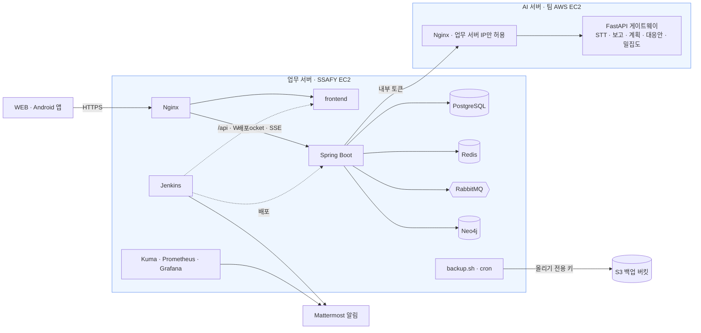
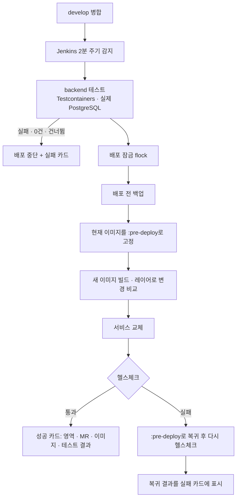

# SceneCrew · 공연 현장 운영 협업 서비스

> 공연 총괄과 현장 운영진이 계획·업무·장비·안전 상황을 한곳에서 확인하고 대응하도록 돕는 WEB/Android 서비스.
> 저는 6인 팀의 **INFRA 담당**으로, 서버 2대 구성, **자동 배포와 실패 시 자동 복귀**, **백업·복구**, **감시·경보**, **Android 앱 배포 체계**를 혼자 맡았습니다.

## 기본 정보

| 항목 | 내용 |
| --- | --- |
| 기간 | 2026.10.06 ~ 2026.11.18 (시연) · 인프라 커밋 2026.10.16 ~ |
| 형태 | SSAFY 15기 2학기 자율 프로젝트 · 6인 팀 (PM 겸 FE 1 · FE 1 · BE 2 · AI 1 · INFRA 1) |
| 역할 | INFRA — 업무·AI 서버 구성, CI/CD, 백업·복구, 모니터링, 보안 설정, Android 서명·배포 |
| 주요 기술 (내 담당) | Docker Compose · Nginx · Jenkins · Bash · PostgreSQL · Prometheus · Alertmanager · Grafana · Uptime Kuma · Let's Encrypt · AWS EC2/S3/IAM · Capacitor Android 서명 |
| 팀 전체 스택 | React · TypeScript · Capacitor · Spring Boot 4 · PostgreSQL · Redis · RabbitMQ · Neo4j · FastAPI · ONNX · FCM |
| 성과 | 11/18 시연 성공 (수상 없음) |
| 링크 | 코드 저장소는 SSAFY 내부 GitLab이라 비공개 |

---

## 1. 문제 정의

콘서트 같은 하루짜리 공연 현장에서는 총괄 한 명이 수십 명의 운영진에게 업무를 나누고, 장비 고장·관객 밀집 같은 상황이 생기면 바로 대응해야 합니다. 지금은 메신저와 종이 계획표로 흩어져 있어서 누가 무엇을 하고 있는지, 보고가 어디까지 처리됐는지 알기 어렵습니다.

SceneCrew는 계획 생성(AI), 개인 업무, 현장 보고(음성 포함), 변경 승인, 장비 상태, 구역별 밀집도를 한 서비스로 묶었습니다.

인프라 관점에서 이 서비스의 요구사항은 이랬습니다.

- **시연 당일에 멈추면 안 됩니다.** 팀원 6명이 하루에도 여러 번 develop에 합치는 상황에서, 잘못된 배포가 서비스를 내려도 스스로 돌아와야 했습니다.
- **데이터 기준이 정해져 있었습니다.** 기획 기준은 매시간 백업, RPO 1시간, RTO 2시간, 3분 주기 상태 감시였습니다.
- **AI 처리가 업무 API를 막으면 안 됩니다.** 음성 전사·보고 분석·계획 생성은 CPU를 오래 씁니다.
- **앱 스토어 없이 Android 앱을 배포해야 했습니다.** 시연용 APK를 직접 나눠 주면서도 옛 버전을 막아야 했습니다.

## 2. 주요 기능

**서비스 전체 (팀)**

- 총괄: 공연 조건·PDF로 AI 계획 후보 생성, 업무 배정·변경 승인, 장비·안전 지도, 종료 요약
- 팀원(Android 앱): 내 업무 시간표, 음성 상황 보고, 알림·채팅, 푸시
- AI: 음성 전사(STT), 보고 분석, 계획 생성·최초 배정, 대응안 생성, 카메라 밀집도 추정

**내 담당 (INFRA)**

- 서버 2대(업무 서버, AI 서버) 구성과 HTTPS
- develop 병합 → 테스트 → 빌드 → 배포 → 헬스체크 → 실패 시 복귀 → Mattermost 알림
- 매시간 암호화 백업, 서버 밖 보관, 격리 복구 훈련, 운영 DB 복원 스크립트
- 서비스 감시(Uptime Kuma)와 자원 경보(Prometheus·Alertmanager·Grafana)
- DB 계정 분리, 경로별 IP 제한, 접근 로그 가리기
- Android Release 서명, App Links, 직접 배포 APK와 강제 업데이트

## 3. 아키텍처

파란 영역 전체가 제가 구성하고 운영한 부분입니다. 애플리케이션 코드는 각 파트가, 컨테이너·네트워크·배포·데이터 보호는 제가 맡았습니다.

**설계 원칙**

- **외부에 여는 포트는 업무 서버 Nginx의 80·443뿐입니다.** Jenkins·Grafana·Kuma는 `127.0.0.1`에만 열고 SSH 터널로 접속합니다. DB·Redis·RabbitMQ에는 `ports`를 쓰지 않습니다. Docker가 공개한 포트는 UFW 규칙을 우회하기 때문입니다.
- **AI 서버는 업무 서버만 부를 수 있습니다.** 보안 그룹과 Nginx 양쪽에서 업무 서버 IP만 허용하고, 내부 토큰을 한 번 더 확인합니다.
- **모든 컨테이너에 메모리 상한을 둡니다.** 16GiB 서버에서 서비스 14개 상한 합계를 약 13GiB로 잡고, 나머지를 OS와 이미지 빌드 몫으로 남겼습니다.
- **비밀값은 저장소 밖에만 둡니다.** 서버 `.env`와 읽기 전용 파일로만 넣고, 채팅·저장소·로그에 남기지 않습니다.

### 배포 흐름

## 4. 기술 스택과 선택 이유

| 기술 | 사용 위치 | 선택 이유 |
| --- | --- | --- |
| Docker Compose | 두 서버 전체 | 서버가 각각 한 대라 오케스트레이터는 과함. 프로필(`app`)로 저장소와 앱을 나눠 띄우고, 이름 있는 볼륨으로 데이터 유지 |
| Nginx | 앞단 프록시 | HTTPS 종료, SSE 경로 버퍼링 해제, WebSocket 업그레이드, `assetlinks.json` 직접 응답, 경로별 IP 제한, 로그 형식 제어를 한곳에서 처리 |
| Jenkins (pollSCM) | 자동 배포 | 서버로 들어오는 Webhook을 열지 않으려고 2분 주기로 변경을 확인. 관리 화면은 SSH 터널로만 접근 |
| Bash 배포 스크립트 | 배포·복귀·백업·복원 | Jenkins와 수동 배포가 같은 스크립트를 쓰게 해서, 장애 때 사람이 해도 같은 절차를 밟게 함 |
| Uptime Kuma | 서비스 감시 | 3분 주기·3회 실패 기준을 바로 설정 가능. 백업 성공 신호를 Push 모니터로 받아 "백업이 멈췄다"도 감지 |
| Prometheus · Alertmanager · Grafana | 자원 경보 | 디스크·메모리·컨테이너 상한 근접·OOM처럼 "죽기 전에" 알아야 하는 신호 담당 |
| OpenSSL AES-256 · S3 | 백업 | 백업 파일 자체를 암호화하고, 서버 밖에는 올리기만 가능한 키로 보관 |
| Let's Encrypt (webroot) | 인증서 | Nginx를 멈추지 않고 갱신. 갱신 후 reload 훅 |

## 5. 설계 결정과 트레이드오프

### 결정 1. 업무 서버와 AI 서버를 물리적으로 분리

- **상황:** 음성 전사·보고 분석·계획 생성은 CPU를 길게 씁니다. 계획 생성은 최대 600초까지 걸립니다.
- **검토한 대안:** 업무 서버 한 대에 AI 컨테이너를 메모리 상한만 걸어 함께 두기.
- **선택과 이유:** AI는 별도 EC2(4 vCPU·16GiB, CPU 전용)로 뺐습니다. CPU는 메모리처럼 상한을 걸어도 업무 API 응답 지연을 완전히 막기 어렵고, 시연 당일 AI 요청이 몰려도 로그인·업무 화면은 살아 있어야 했습니다.
- **감수한 비용:** 서버가 하나 늘어 비용(시간당 약 0.25달러)과 관리 대상이 늘었습니다. 쓰지 않는 기간에는 인스턴스를 중지해 비용을 줄였습니다. 또 AI 서버는 GitLab에 접근할 수 없어 자동 배포 대신 `git bundle`로 코드를 옮겨 수동 배포합니다.

### 결정 2. 배포 실패 시 "이미지만" 자동 복귀, 데이터는 배포 전 백업으로

- **상황:** 헬스체크가 실패하면 이전 버전으로 돌아가야 합니다. 그런데 Flyway 마이그레이션처럼 이미 DB에 적용된 변경은 이미지를 바꿔도 되돌아가지 않습니다.
- **선택:** 자동 복귀는 이미지까지만 하고, 배포마다 **배포 직전 백업**을 따로 남겼습니다. 데이터까지 되돌려야 하는 경우는 사람이 판단해 복원 스크립트로 처리합니다.
- **이유:** 데이터 복원은 그 사이에 쓴 데이터를 잃는 결정이라 자동으로 하면 안 된다고 봤습니다.
- **감수한 비용:** 마이그레이션이 잘못된 배포는 자동으로 완전히 복구되지 않습니다. 대신 실패 카드에 "되돌렸지만 헬스체크 실패" 상태를 따로 표시해 사람이 바로 알 수 있게 했습니다.

### 결정 3. 앱 DB 계정을 superuser에서 분리

- **상황:** 처음에는 backend가 DB 관리자 계정으로 붙어 있었습니다. 앱 버그나 SQL 인젝션 한 번으로 테이블 삭제까지 가능한 상태였습니다.
- **선택:** 계정을 셋으로 나눴습니다.
  - 관리 계정: 백업·복구에만 사용
  - 마이그레이션 계정: Flyway 전용, 테이블 소유자
  - 앱 계정: 업무 테이블 읽기·쓰기만. DDL과 Flyway 이력 접근 불가
- `ALTER DEFAULT PRIVILEGES`로 나중에 마이그레이션이 만드는 테이블에도 앱 권한이 자동으로 붙게 했습니다. 스크립트는 여러 번 실행해도 결과가 같습니다.
- **전환 순서가 핵심이었습니다.** compose가 새 계정으로 접속하도록 바뀌므로, **계정을 먼저 만들고 나서** 병합해야 했습니다. 순서가 바뀌면 배포 헬스체크가 실패하고, 복귀해도 같은 설정이라 backend가 뜨지 않습니다. 그래서 병합 전 브랜치의 스크립트를 서버에서 먼저 실행하는 절차를 문서로 만들었습니다.
- **검증:** 최신 백업을 임시 DB에 복원해 실제 backend 이미지로 기동하고, 앱 계정의 DROP·CREATE·TRUNCATE가 거부되는지 확인했습니다.

### 결정 4. 서버 밖 백업은 "올리기 전용" 키로

- **상황:** 백업이 서버 디스크에만 있으면 서버를 잃을 때 백업도 같이 잃습니다.
- **선택:** S3 버킷에 올리되, 서버에 두는 IAM 키는 `PutObject`만 허용했습니다. 버킷은 퍼블릭 차단, 30일 수명 주기 규칙을 걸었습니다.
- **이유:** 서버가 뚫려도 공격자가 S3 사본을 읽거나 지울 수 없게 하려고 했습니다.
- **감수한 비용:** 복원할 때 서버 키로는 내려받을 수 없어 콘솔에서 직접 받아야 합니다. 복원 절차 문서에 그 순서를 넣었습니다.

### 결정 5. 앱 스토어 없이 APK 직접 배포와 강제 업데이트

- **상황:** 시연용 앱을 스토어 심사 없이 배포해야 했습니다. 그런데 앱 화면은 APK 안에 묶여 있어서, 웹을 배포해도 이미 설치된 앱 화면은 바뀌지 않습니다.
- **선택:**
  - Release 서명 키를 만들고 보관 정책(접근 2명, 저장소 밖, 오프라인 백업)을 정했습니다. 공개 정보인 지문만 공유합니다.
  - 서버의 `latest.json`에 최신 버전과 **최소 버전**을 두고, 앱이 켜질 때 확인해 최소 버전보다 낮으면 업데이트 화면만 보이게 했습니다.
  - `assetlinks.json`을 Nginx가 직접 응답하게 해서 Google의 App Links 검증을 통과했습니다.
- **감수한 비용:** 서명 키를 잃으면 같은 앱으로 업데이트할 수 없습니다. 키 보관을 팀 비밀번호 관리 장소와 오프라인 사본 두 곳에 나눴습니다.

## 6. 트러블슈팅

### 문제 1. 배포가 실패했는데 되돌릴 이미지가 없음

- **문제:** 배포 스크립트는 빌드 전 이미지 ID를 기억했다가 실패하면 그 이미지에 `:previous` 태그를 붙여 되돌리는 구조였습니다. 그런데 빌드 직후 태그 붙이기가 실패했습니다(Jenkins #22).
- **원인:** 서버 Docker가 **containerd 이미지 저장소**를 쓰고 있었습니다. 새 이미지가 같은 태그를 가져가면 태그가 떨어진 옛 이미지가 바로 지워져서, 기억해 둔 ID가 더 이상 존재하지 않았습니다. 게다가 BuildKit은 attestation 때문에 **내용이 같아도 빌드마다 이미지 ID가 달라서**, ID 비교로는 "바뀐 서비스"도 판별할 수 없었습니다.
- **해결:**
  - 빌드 **전에** 현재 이미지를 `:pre-deploy` 태그로 붙잡아 지워지지 않게 했습니다.
  - 변경 여부는 이미지 ID가 아니라 **레이어 목록(RootFS.Layers)**으로 비교했습니다.
  - 헬스체크 실패 시 `:pre-deploy`로 되돌리고 **한 번 더 헬스체크**해서, 복귀가 실제로 성공했는지까지 카드에 남겼습니다.
- **결과:** 이후 배포에서 복귀 대상이 항상 남아 있게 됐습니다. 이 일을 계기로 "서버에서 검증하지 않은 배포 스크립트 변경은 병합하지 않는다"는 규칙을 세웠습니다.

### 문제 2. 첫 backend 배포가 빌드 단계에서 실패

- **문제:** backend Dockerfile이 처음 들어온 날, Jenkins 빌드가 `RUN --mount` 문법 오류로 실패했습니다.
- **원인:** Jenkins 컨테이너 이미지에 **Docker Buildx가 없어서** BuildKit 대신 옛 빌더로 빌드되고 있었습니다. `--mount`는 BuildKit 전용 문법입니다.
- **해결:** 당일에는 BE가 Dockerfile에서 해당 문법을 빼서 배포를 살렸고, 근본 해결로 Jenkins 이미지에 Buildx를 넣었습니다.
- **결과:** 실패 알림 카드가 설계대로 발송돼, 배포 실패를 팀이 즉시 알았습니다. 알림 경로가 실제로 동작한다는 것도 이때 확인했습니다.

### 문제 3. 배포 두 개가 겹치면 서로를 덮어씀

- **문제:** Jenkins 자동 배포와 수동 배포가 동시에 돌면, 한쪽이 빌드한 이미지를 다른 쪽이 덮어써 상태가 꼬일 수 있었습니다.
- **해결:** 배포 스크립트 전체를 `flock`으로 잠갔습니다. 다른 배포가 진행 중이면 최대 15분 기다리고, 그래도 안 끝나면 **아무것도 바꾸지 않고** "배포 대기 실패"로 멈춥니다. 복원 스크립트도 같은 잠금을 잡아, 복원 중에는 배포가 끼어들지 못하게 했습니다.

### 문제 4. 백업이 쌓이자 "최근 백업 찾기"가 조용히 실패

- **문제:** 복구 훈련 스크립트가 어느 순간부터 최근 백업을 찾지 못하고 멈췄습니다.
- **원인:** `ls -1t ... | head -1`로 최근 파일을 골랐는데, `head`는 첫 줄만 읽고 파이프를 닫습니다. 백업 파일이 많아지면 `ls`가 남은 출력을 쓰다 **SIGPIPE**로 끝나고, 스크립트의 `set -o pipefail`이 이를 실패로 처리했습니다. 파일이 적을 때는 재현되지 않아 처음 테스트에서 놓쳤습니다.
- **해결:** 끝까지 읽는 `sed -n 1p`로 바꾸고, 같은 이유를 주석으로 남겼습니다.
- **배운 점:** "데이터가 쌓인 뒤에야 드러나는 버그"가 있다는 것, 그래서 복구 훈련은 한 번이 아니라 주기적으로 돌려야 한다는 것을 알게 됐습니다.

### 문제 5. AI 컨테이너를 다시 만들면 Nginx가 502

- **문제:** AI 서버에서 설정을 바꾸려고 `ai` 컨테이너만 다시 만들면, Nginx가 계속 502를 돌려줬습니다.
- **원인:** Nginx는 시작할 때 upstream 이름을 IP로 한 번만 풀어 둡니다. 컨테이너를 다시 만들면 내부 IP가 바뀌는데 Nginx는 옛 IP로 계속 보냈습니다.
- **해결:** Docker 내부 DNS를 `resolver`로 지정하고 upstream을 변수로 써서 **요청마다 주소를 다시 찾게** 했습니다. 감시용 `/health` 경로도 같은 IP 제한으로 열었습니다.
- **결과:** 가짜 AI 컨테이너로 IP가 바뀌게 재생성하는 시험을 해서, 이전 설정은 502, 바꾼 설정은 200임을 확인했습니다. 이후 AI 쪽 설정 변경·되돌리기에 Nginx 재시작이 필요 없어졌습니다.

### 문제 6. 녹음·문서 업로드가 413으로 막힘

- **문제:** 합계 30MB를 꽉 채운 업로드가 backend에 닿기도 전에 413으로 거절됐습니다.
- **원인:** Nginx 상한을 기획의 "파일 합계 30MB"에 맞춰 30MB로 뒀는데, multipart 요청에는 경계 문자열과 헤더가 더 붙어서 실제 요청은 30MB보다 큽니다. backend는 이를 고려해 요청 상한을 32MB로 잡고 있었습니다.
- **해결:** Nginx 상한을 backend의 요청 상한과 같은 32MB로 맞추고, 이유를 설정 파일에 주석으로 남겼습니다.

### 문제 7. Grafana가 메모리 상한에 걸려 경보를 냄

- **문제:** 대시보드를 30초 새로고침으로 열어 두자 Grafana가 컨테이너 메모리 상한에 근접해 경보가 울렸습니다.
- **원인:** 처음 상한(256MiB → 512MiB)이 실제 사용량보다 작았고, Go 런타임은 상한을 모른 채 힙을 키웁니다.
- **해결:** 상한을 1GiB로 올리고 `GOMEMLIMIT`(800MiB)을 함께 설정해 Go GC가 상한 안에서 메모리를 회수하게 했습니다. 감시 도구가 스스로 경보를 낸 덕에 OOM 전에 잡았습니다.

### 문제 8. 접근 로그에 초대 토큰과 OAuth 코드가 남음

- **문제:** 초대 링크는 `/invites/{token}` 형식이라 Nginx 접근 로그에 토큰이 그대로 남았습니다. 소셜 로그인 콜백의 `code`·`state` 같은 쿼리 문자열, 초대 주소가 담긴 Referer도 마찬가지였습니다.
- **해결:** 로그 형식을 새로 정의했습니다.
  - 쿼리 문자열과 Referer는 아예 남기지 않습니다.
  - 초대 경로의 토큰은 `map`으로 `***`로 바꿉니다.
  - 프런트엔드 컨테이너의 중복 접근 로그는 껐습니다.
- **검증:** 운영 인증서·변수로 렌더링한 설정을 임시 Nginx 컨테이너에 띄워, 토큰 경로 4건은 가려지고 초대 경로가 아닌 곳은 그대로 남는지 확인했습니다.
- **남은 한계:** Nginx 오류 로그는 형식을 바꿀 수 없어, 413·403 같은 오류에서는 요청 줄이 남을 수 있습니다. 문서에 한계로 적어 두었습니다.

### 문제 9. 웹은 새 화면인데 앱만 옛 화면

- **문제:** 시연 직전, 팀원들이 "앱으로 들어가면 이전 버전 화면이고 로그인 화면도 다르다"고 했습니다.
- **원인:** Capacitor 앱은 화면(웹 빌드 결과)을 APK 안에 묶습니다. 웹을 몇 번 배포해도 설치된 앱은 마지막 APK 시점의 화면을 그대로 씁니다. 공개 APK가 며칠 전 버전에 머물러 있었습니다.
- **해결:** 새 버전(versionCode 9)을 서명해 빌드하고, 서명 지문이 승인된 키와 같은지 확인한 뒤 서버에 올렸습니다. `latest.json`의 최소 버전도 함께 올려서 **옛 앱은 업데이트 화면만 보이게** 했습니다. 되돌릴 수 있게 이전 `latest.json`은 백업해 두었습니다.

### 문제 10. 휴대폰으로 초대 QR을 찍으면 화면이 깨짐

- **문제:** 총괄이 보여 주는 초대 QR을 휴대폰으로 찍으면 PC용 웹 화면이 열려 깨졌습니다.
- **해결:**
  - Android 브라우저는 로그인 전에 "앱으로 열기" 안내를 먼저 보입니다. 버튼은 Android `intent` 주소라 앱이 있으면 같은 초대가 앱에서 열리고, 없으면 APK 내려받기 페이지로 갑니다. 내려받기 주소에는 초대 토큰을 넣지 않았습니다.
  - iPhone은 앱이 없으므로, 휴대폰 브라우저에서는 앱과 같은 레이아웃을 쓰게 했습니다.
- **결과:** e2e 테스트(Playwright) 405개 통과 후 배포했습니다. 실제 iPhone 기기 확인 결과는 따로 기록하지 못했습니다.

### 문제 11. 시연 직전 "AI 대응안이 계속 실패"

- **문제:** 배포 동결일에 AI 담당자가 "대응안 생성이 계속 실패하는데 화면에는 실패 코드만 보인다"고 요청했습니다. AI 서버와 DB는 다른 팀원이 접속할 수 없었습니다.
- **조사:**
  - 업무 서버 DB의 작업 기록에서 상세 오류를 읽었습니다. 다섯 번 모두 AI 검토 단계가 "대응이 늦다"며 통과시키지 않은 것이었습니다.
  - 같은 작업의 공연 운영 시간을 대조해 보니 **시험 공연이 3일 전에 이미 끝나 있었습니다.** 끝난 운영 구간에 맞춰 만든 대응 업무를, 검토 단계가 "지금" 기준으로 늦다고 판단한 것입니다.
- **결과:** 서버나 배포 문제가 아니라 시험 데이터 조건 문제라는 근거를 AI 담당자에게 넘겼고, 시연 당일에는 공연 시각을 당일로 맞춰야 한다는 점도 함께 알렸습니다. 이 과정에서 서버 설정은 하나도 바꾸지 않았습니다.

## 7. 내가 작업한 것

**서버 구성**

- 업무 서버: Nginx·frontend·backend·PostgreSQL(pgvector)·Neo4j·Redis·RabbitMQ와 운영 도구 7종 compose 구성, 서비스별 메모리 상한
- AI 서버: EC2 생성, Docker 설치, 보안 그룹, IP 제한 Nginx, 모델 볼륨 배치, 비용 관리(미사용 시 중지)
- HTTPS(Let's Encrypt webroot 갱신), SSE 버퍼링 해제, WebSocket 업그레이드, 업로드 상한

**배포**

- Jenkins 이미지(Buildx 포함)와 파이프라인, backend 테스트 단계(Testcontainers)
- `deploy.sh`: 잠금, 배포 전 백업, `:pre-deploy` 고정, 레이어 비교, 복귀 후 재확인, Nginx 설정 변경 시 `nginx -t` 검사 후 재생성
- Mattermost 배포 카드: 바뀐 영역, MR(함께 배포된 MR 전부), 커밋, 이미지, 테스트 결과
- 배포 동결 절차와 예외 배포 절차

**데이터 보호**

- `backup.sh`(매시간, AES-256, 30일, S3 사본), `restore-drill.sh`(격리 복구 훈련), `restore.sh`(운영 복원, 복원 직전 사본 자동 생성)
- DB 계정 3분리 스크립트(`setup-db-roles.sh`)
- 볼륨 데이터 유지 검증(PostgreSQL·Redis·RabbitMQ·Neo4j 재생성 후 유지)
- 빌드 캐시 주간 정리

**감시와 보안**

- Uptime Kuma 감시 7종과 백업 Push 감시, Prometheus 경보 규칙 7종, Grafana 대시보드
- 접근 로그 가리기, 장비 수집 경로와 AI 내부 경로의 IP 제한, Firebase 키 읽기 전용 마운트

**Android 배포**

- Release 서명 키 생성·보관 정책, App Links(`assetlinks.json`)
- 공개 APK 빌드·서명 확인·업로드, `latest.json` 최소 버전 관리

**문서**

- 인프라 README(구성, 실행, 복구, 장애 확인 절차), 포팅 매뉴얼 인프라 부분, 환경변수 명세, 시연 준비 문서

**기여 지표 (git 기준, 2026-11-16)**

| 항목 | 값 |
| --- | --- |
| 내 커밋 | 69개 (merge 제외) |
| `infra/` 폴더 커밋 | 44개 중 37개 (84%) |
| 자동 배포 | Jenkins 빌드 300회 이상 (#302 기준) |
| 프로젝트 전체 | 커밋 1,479개 · MR 병합 379건 |

## 8. 작업 타임라인

| 기간 | 작업 |
| --- | --- |
| 10.16 ~ 10.20 | 저장소 구조·개발환경 문서, 배포 구성 초안. 기획 v4.1 기준 서버 2대 구성 |
| 10.22 | 서버 수령 당일 업무 서버 가동: 저장소 컨테이너, HTTPS, Uptime Kuma, 매시간 백업과 복구 훈련 |
| 10.26 ~ 10.27 | 프런트엔드 첫 배포, Jenkins 자동 배포와 Mattermost 카드, backend 테스트 단계, Buildx 문제 해결 |
| 10.28 | 배포 복귀 이미지 문제 해결, 동시 배포 잠금, Prometheus·Grafana 경보, App Links, 데이터 유지 검증 |
| 10.29 ~ 10.30 | DB 계정 분리, 운영 복원 스크립트·리허설(API 중단 22초), AI 서버 EC2 생성·배포, AI Nginx 502 해결 |
| 11.02 ~ 11.06 | S3 백업 외부 보관, 업로드 상한 수정, 장비 수집 경로 개방, 접근 로그 가리기, 소셜 로그인 설정 |
| 11.09 ~ 11.11 | 업무 서버 ↔ AI 서버 연결(계획·배정), 포팅 매뉴얼, 운영 푸시(FCM) 켜기 |
| 11.12 ~ 11.13 | 앱 화면 정리, 공개 APK 0.7.0 배포, 초대 QR 앱 연결, 카메라 밀집도 AI 전환 |
| 11.16 | 배포 동결. 승인받은 예외로 AI 서버 재배포, AI 대응안 실패 원인 조사 |
| 11.18 | 시연 성공 · 프로젝트 종료 (수상 없음) |

## 9. 한계와 다음 개선

- **부하 검증을 하지 못했습니다.** 기획에는 93명 동시 사용 부하 검증이 있었지만 기능 통합이 늦어지면서 시연 전까지 진행하지 못했습니다. 다음에는 배포 체계와 함께 부하 시험 스크립트를 초기에 만들어 두고 싶습니다.
- **AI 서버는 자동 배포가 없습니다.** 저장소 접근 제약 때문에 `git bundle`로 수동 배포했고, 그래서 배포 알림도 가지 않습니다. 레지스트리에 이미지를 올리고 AI 서버가 받아 가는 구조로 바꾸면 자동화와 알림을 같이 해결할 수 있습니다.
- **backend 애플리케이션 지표가 없습니다.** 서버·컨테이너 자원은 보지만, API 응답 시간과 5xx 비율은 BE가 Actuator Prometheus 엔드포인트를 열기 전이라 경보를 걸지 못했습니다.
- **서버 재부팅 후 자동 기동을 검증하지 못했습니다.** 두 서버 모두 커널 업데이트로 재부팅이 필요한 상태지만, 시연 일정 때문에 미뤘습니다.
- **복원 시간이 아직 작은 데이터 기준입니다.** RTO 리허설(API 중단 22초)은 덤프 약 60KB 시점 값이라, 데이터가 늘면 다시 재야 합니다.
- **AI 서버 HTTPS가 없습니다.** 도메인이 없어 인증서를 받을 수 없었고, 대신 IP 제한과 내부 토큰으로 막았습니다.

## 10. 배운 점

- **자동화는 "실패한 날"을 기준으로 설계해야 합니다.** 배포 자동화 자체보다, 실패했을 때 되돌릴 대상이 진짜 남아 있는지, 되돌린 뒤 살아났는지, 두 배포가 겹치면 어떻게 되는지를 챙기는 데 시간이 더 들었고 그게 더 중요했습니다.
- **백업은 복원해 봐야 백업입니다.** 복구 훈련을 주기적으로 돌린 덕분에 "파일이 쌓인 뒤에만 나는 버그(SIGPIPE)"나 "권한이 든 백업은 기존 방식으로 복원이 안 되는 문제"를 실제 장애 전에 찾았습니다.
- **인프라 설정은 다른 파트의 숫자와 맞아야 합니다.** 업로드 상한, 타임아웃, 접속 계정처럼 Nginx·backend·AI가 같은 값을 가져야 하는 곳에서 문제가 자주 났습니다. 이후에는 설정 파일에 "어느 값과 맞춘 것인지"를 주석으로 남기는 습관을 들였습니다.
- **운영 변경은 백업과 되돌리기 방법이 먼저입니다.** `.env` 하나를 바꿔도 백업 파일을 남기고, 이미지를 바꾸기 전 태그로 붙잡아 두는 식으로 "언제든 1분 안에 돌아갈 수 있는 상태"를 유지했습니다.
- **혼자 맡은 영역일수록 문서가 팀의 인터페이스입니다.** 다른 팀원이 서버에 접속하지 않아도 상태를 이해하고 요청할 수 있도록, 절차·검증 결과·확인하지 않은 것을 README에 함께 적었습니다.

## 11. 예상 면접 질문

Q. 배포가 실패하면 어떻게 되나요?

배포 직전 이미지를 `:pre-deploy` 태그로 붙잡아 두고, 새 이미지로 바꾼 뒤 헬스체크가 실패하면 그 이미지로 되돌립니다. 되돌린 뒤 한 번 더 헬스체크해서, 복귀까지 실패하면 알림 카드에 "되돌렸지만 헬스체크 실패"로 따로 표시합니다. 다만 이미지만 되돌리기 때문에 이미 적용된 DB 마이그레이션은 그대로입니다. 그래서 배포마다 배포 직전 백업을 남기고, 데이터 복원은 사람이 판단하게 했습니다.

Q. 왜 이미지 ID로 이전 이미지를 관리하지 않았나요?

처음에는 이미지 ID로 관리했는데 실제로 실패했습니다. 서버 Docker가 containerd 이미지 저장소를 써서, 태그가 떨어진 옛 이미지가 빌드 중에 지워졌습니다. 또 BuildKit은 내용이 같아도 빌드마다 ID가 달라서 ID로는 변경 여부도 알 수 없었습니다. 그래서 빌드 전에 태그로 붙잡아 지워지지 않게 하고, 변경 여부는 레이어 목록으로 비교했습니다.

Q. RPO 1시간, RTO 2시간은 어떻게 맞췄나요?

RPO는 매시 5분 cron 백업으로 맞췄고, 백업 성공 신호가 65분 넘게 없으면 Uptime Kuma가 알리게 해서 백업이 멈춘 것도 감지합니다. RTO는 복원 스크립트를 만들고 운영과 분리된 환경에서 리허설해 API 중단 22초를 확인했습니다. 다만 데이터가 작을 때 값이라 데이터가 늘면 다시 재야 한다고 문서에 적어 두었습니다.

Q. 백업 파일이 유출되면 어떻게 되나요?

백업 파일은 AES-256으로 암호화하고 키는 서버와 팀 비밀번호 관리 장소에 따로 둡니다. 서버 밖 S3 사본은 서버에 올리기 전용 키만 두어서, 서버가 뚫려도 S3 사본을 읽거나 지울 수 없습니다. 버킷은 퍼블릭 접근을 막고 30일 뒤 자동 만료됩니다.

Q. Kubernetes 대신 Docker Compose를 쓴 이유는?

서버가 업무용·AI용 각각 한 대였고, 시연까지 약 한 달이었습니다. 노드가 한 대인 상황에서 오케스트레이터는 학습·운영 비용에 비해 얻는 것이 적다고 봤습니다. 대신 Compose의 헬스체크, 메모리 상한, 이름 있는 볼륨을 쓰고, 오케스트레이터가 해 주던 롤백·동시 배포 방지는 배포 스크립트로 직접 구현했습니다.

Q. Docker가 연 포트가 UFW를 우회한다는 건 무슨 뜻인가요?

Docker는 `ports`로 공개한 포트를 iptables에 직접 규칙으로 넣는데, 이 규칙이 UFW 규칙보다 먼저 적용됩니다. 그래서 UFW에서 막아도 외부에서 접근할 수 있습니다. 그래서 DB·Redis·RabbitMQ에는 `ports`를 아예 쓰지 않고, 관리 도구는 `127.0.0.1`에만 열어 SSH 터널로 접속했습니다.

Q. 혼자 인프라를 맡으면서 팀과 어떻게 협업했나요?

다른 팀원은 서버에 직접 접속하지 않아서, 배포 결과를 Mattermost 카드로 바로 보이게 했습니다. 카드에는 어떤 MR이 어떤 영역을 바꿨고 테스트 결과가 어땠는지가 나옵니다. 서버 상태를 확인해 달라는 요청이 오면 읽기 전용으로 먼저 확인하고, 운영 설정을 바꾸는 일은 근거와 되돌리기 방법을 정리해 승인을 받은 뒤 진행했습니다.

---

> 작성 기준: 프로젝트 Git 기록, 인프라 README, 서버 작업 기록을 바탕으로 정리했습니다. 소스 코드 원문, 서버 주소, 계정·키 정보, 내부 자료는 싣지 않았습니다.
