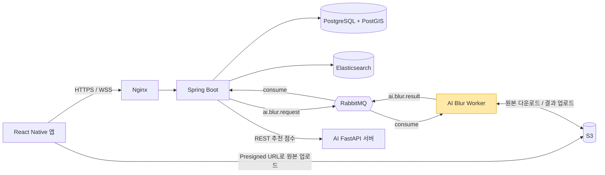
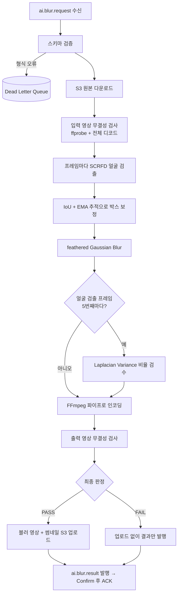

# 와글와글 · 위치 기반 실시간 현황 공유 서비스

> 지금 그 장소가 얼마나 붐비는지, 현장에서 찍은 5초 영상으로 확인하는 서비스.
> 저는 6인 팀의 **팀장**이자 **AI 담당**으로, 업로드 영상의 **얼굴 비식별화(블러) 파이프라인**과 **AI 워커 배포**를 맡았습니다.

## 기본 정보

| 항목 | 내용 |
| --- | --- |
| 기간 | 2026.07.06 ~ 2026.08.10 (개발 커밋 2026.07.13 ~ 08.13) |
| 형태 | SSAFY 15기 2학기 공통 프로젝트 · 6인 팀 (FE 2 · BE 2 · AI 2) |
| 역할 | 팀장 · AI — 얼굴 블러/자동 검수 파이프라인 설계·구현, AI 워커 배포, AI↔BE 메시지 명세 |
| 주요 기술 (내 담당) | Python 3.12 · InsightFace(SCRFD) · OpenCV · FFmpeg · aio-pika(RabbitMQ) · Pydantic v2 · Docker · Jenkins |
| 팀 전체 스택 | React Native(Expo) · Spring Boot · FastAPI · RabbitMQ · PostgreSQL/PostGIS · Elasticsearch · S3 · Prometheus/Grafana |
| 성과 | **SSAFY 공통 프로젝트 우수상** |
| 링크 | 코드 저장소는 SSAFY 내부 GitLab이라 비공개 · 시연 영상: 추가 예정 |

---

## 1. 문제 정의

지도·포털 앱이 보여주는 혼잡도는 **과거 방문 데이터로 추정한 값**이라 "지금"과 어긋나는 경우가 많습니다.
SNS에 올라오는 현장 정보는 흩어져 있고, **언제 어디서 찍었는지** 확인하기 어렵습니다.
그래서 사용자는 만석·긴 대기줄·품절 때문에 헛걸음을 하게 됩니다.

와글와글은 이 문제를 이렇게 풀었습니다.

- 현장에 있는 사람이 **앱 안에서 바로 찍은 5초 영상**을 핀으로 올립니다. 갤러리 업로드는 막아 "지금 여기"를 보장합니다.
- 다른 사용자는 지도에서 장소별 최근 혼잡도와 영상 핀을 확인합니다.
- 핀은 매일 04시 기준 24시간만 노출됩니다.

이 구조에서 가장 먼저 풀어야 할 문제는 **타인의 얼굴**이었습니다.
사람이 붐비는 장소를 찍으면 모르는 사람의 얼굴이 반드시 담기기 때문에, **얼굴이 가려지지 않은 영상은 절대 공개되면 안 된다**는 것이 AI 파트의 핵심 요구사항이었습니다.

## 2. 주요 기능

**서비스 전체 (팀)**

- 카카오/네이버 OAuth 로그인과 온보딩 (선호 장소 카테고리 선택)
- 지도 기반 홈: 와글/여유 필터, 최근 1시간 혼잡도 평균으로 장소 정렬
- 장소·태그 검색 (Elasticsearch), 장소별 요일·시간대 붐빔 통계
- 영상 핀 등록: 인앱 촬영, 반경 내 장소 선택, 혼잡도 4단계 직접 선택, 메모·태그
- 크레딧(열람 차감·평가 적립)과 신뢰도 온도
- 1:1 익명 채팅과 AI 채팅 위험 감지 (외부 메신저 유도·계좌 요구 패턴 경고)
- AI 장소 추천

**내 담당 (AI 블러)**

- 업로드된 원본 영상에서 **모든 프레임의 얼굴을 검출해 블러**
- 블러가 충분히 됐는지 **자동 검수** → PASS일 때만 핀 공개, FAIL이면 재촬영 유도
- 블러된 영상과 썸네일(WebP)을 만들어 S3에 저장
- 처리 결과를 RabbitMQ로 백엔드에 전달

> 혼잡도는 AI가 추정하지 않습니다. 초기 기획에는 "사람 탐지 기반 혼잡도 자동 분류"가 있었지만, 요구사항 v2에서 MVP 범위 밖으로 뺐고 게시자가 4단계를 직접 고르는 방식으로 확정했습니다.

## 3. 아키텍처



노란색이 제가 맡은 영역입니다.

**설계 원칙**

- **앱은 AI를 직접 호출하지 않습니다.** AI 결과는 백엔드만 저장하고, 백엔드가 앱에 전달합니다.
- 영상 파일은 메시지에 싣지 않습니다. 앱이 Presigned URL로 S3에 올리고, 메시지에는 **Object Key만** 담습니다. 서명 URL은 만료되기 때문에 비동기 메시지에 넣으면 안 됩니다.
- 업로드 요청은 **202 Accepted로 즉시 응답**하고 블러는 비동기로 처리합니다. 사용자는 처리를 기다리지 않고 앱을 계속 쓸 수 있습니다.
- **API 서버와 블러 워커를 다른 컨테이너로 분리했습니다.** 이미지는 같지만, 블러는 CPU를 오래 점유해서 같은 프로세스에 두면 추천 API 응답이 밀립니다.

### 블러 처리 흐름



## 4. 기술 스택과 선택 이유

| 기술 | 사용 위치 | 선택 이유 |
| --- | --- | --- |
| InsightFace SCRFD | 얼굴 검출 | 얼굴 **위치(bbox)만** 필요하고 신원 인식은 필요 없음. 다인원 검출, 사전학습 모델 사용 가능. Haar Cascade · MediaPipe · YOLO와 비교 |
| OpenCV | 블러, 검수 | 블러와 품질 판정은 모델이 아니라 **결정적인 알고리즘**으로 처리해 비용과 재현성 확보 |
| FFmpeg (stdin 파이프) | 인코딩 | OpenCV `VideoWriter`는 오디오를 버리고 코덱 선택이 제한적. 원본 오디오 보존과 H.264 출력이 필요 |
| RabbitMQ + aio-pika | BE↔AI 비동기 | 영상 처리가 수 초~수십 초 걸려 동기 REST로는 타임아웃 위험. durable 큐, manual ACK, Publisher Confirm, DLQ로 메시지 유실 방지 |
| Pydantic v2 (`extra="forbid"`) | 메시지 스키마 | 명세에 없는 필드가 오면 바로 거부해 BE·AI 간 계약이 어긋나는 것을 빨리 발견 |
| Docker 3-stage 빌드 | AI 이미지 | test 단계에서 mypy · pytest · ruff가 실패하면 이미지 자체를 만들지 않음. runtime은 non-root 사용자로 실행 |
| Jenkins | AI 배포 | 헬스체크 실패 시 이전 이미지로 자동 롤백 |

## 5. 설계 결정과 트레이드오프

### 결정 1. 블러 검수를 "AI 재검출" 대신 "선명도 비교"로

- **상황:** 블러가 충분히 됐는지 자동으로 판정해야 했습니다. 처음 떠오른 방법은 블러된 프레임을 다시 얼굴 검출 모델에 넣어 "얼굴이 다시 검출되면 블러 실패"로 보는 것이었습니다.
- **문제:** SCRFD는 **충분히 흐려진 얼굴도 윤곽과 형태만으로 다시 검출합니다.** 재검출 여부로는 블러 성공과 실패를 구분할 수 없었습니다. 게다가 검수를 위해 모델 추론을 한 번 더 돌려야 해서 처리 시간도 늘어납니다.
- **선택:** 블러 단계에서 얻은 **얼굴 좌표를 재사용**해 같은 프레임, 같은 위치의 **원본 ROI와 블러 ROI의 선명도(Laplacian Variance)를 비교**했습니다.

  ```
  sharpnessRatio = 블러 ROI의 Laplacian 분산 ÷ 원본 ROI의 Laplacian 분산
  sharpnessRatio ≤ 0.6 → 해당 얼굴 PASS
  ```

  - 역할을 나눴습니다. **모델은 얼굴 위치만 찾고, 블러와 검수는 OpenCV 알고리즘이 맡습니다.**
  - 검수 단계의 **모델 추론 호출을 없앴습니다.** 검출 좌표를 그대로 쓰니 좌표 불일치도 생기지 않습니다.
- **감수한 비용:** 0.6은 초기 실험으로 정한 기준이지 검증된 품질 보증값이 아닙니다. 설계 문서에도 "0.5 / 0.6 / 0.65 비교와 사람 판정 대조가 필요하다"고 남겨두었습니다. (→ 9. 한계)

### 결정 2. 검수는 샘플링, 블러는 전수

- **상황:** 모든 프레임의 모든 얼굴을 검수하면 비용이 프레임 수에 비례해 늘어납니다.
- **선택:** 블러는 **모든 프레임**에 적용하고, 검수만 **얼굴이 검출된 프레임 5개 중 1개**에서 합니다. 전체 프레임 기준이 아니라 얼굴이 있는 프레임 기준으로 세기 때문에, 얼굴이 잠깐 나오는 영상에서도 검수가 건너뛰어지지 않습니다.
  - 모든 검출 프레임을 검수하는 방식에 비해 검수 실행 횟수가 1/5로 줄어듭니다(80% 감소).
- **안전장치:** 검수 대상 얼굴 중 **하나라도 FAIL이면 영상 전체가 FAIL**입니다. 얼굴은 있는데 검수된 얼굴이 하나도 없으면 `NO_FACE_VALIDATED`로 실패 처리합니다.
- **감수한 비용:** 검수하지 않은 프레임의 품질 저하는 놓칠 수 있습니다. 간격(`validate_interval`)을 설정값으로 빼서 필요하면 전수 검수로 바꿀 수 있게 했습니다.

### 결정 3. "검수 실패"와 "시스템 오류"를 다른 상태로

결과 메시지를 설계할 때 가장 신경 쓴 부분입니다. 둘을 하나로 묶으면, 서버 장애가 났을 때도 사용자에게 "다시 찍어주세요"라고 안내하게 됩니다.

| 상태 | processingStatus / finalStatus | 영상·썸네일 키 | 핀 상태 | 사용자 경험 |
| --- | --- | --- | --- | --- |
| PASS | COMPLETED / PASS | 필수 | ACTIVE (BE가 S3 실제 존재 확인 후) | 핀 공개 |
| FAIL | COMPLETED / FAIL | null | REJECTED | 재촬영 안내 |
| FAILED | FAILED / null | null | FAILED | 재촬영을 요구하지 않음 |

- **FAIL**은 "블러 품질이 기준 미달"이라는 **비즈니스 결과**입니다. `code=BLUR_VALIDATION_FAILED`와 실패 사유 목록(`reasonCodes`: `SHARPNESS_RATIO_EXCEEDED`, `ROI_TOO_SMALL`, `LOW_ORIGINAL_SHARPNESS`)을 담습니다.
- **FAILED**는 디코딩·인코딩·저장소·모델 실행 같은 **시스템 오류**입니다. `errorCode`(`VIDEO_DECODE_FAILED`, `STORAGE_ACCESS_FAILED`, `MODEL_EXECUTION_FAILED` 등)를 담습니다.
- FAIL과 FAILED 모두 DLQ가 아니라 **result 큐로 정상 발행**합니다. DLQ는 "메시지 형식 자체가 잘못된 경우"만을 위한 곳으로 남겼습니다.
- 백엔드에서는 **작업 상태**(`ai_blur_jobs.status`: 기술적으로 끝났는가)와 **영상 상태**(`pins.video_status`: 공개해도 되는가)를 분리했습니다.
- 처리 파라미터(검출 임계값, 마진, 검수 간격, 선명도 기준)는 메시지에 싣지 않고 **AI 설정값으로만 관리**합니다. 백엔드가 품질 기준을 바꿀 수 없게 하기 위해서입니다.

### 결정 4. 메시지 처리 보장: "결과 발행이 확인된 뒤에만 ACK"

- 채널은 `prefetch_count=1`, Publisher Confirm, `mandatory=True`(라우팅 안 된 메시지는 발행 실패로 처리), persistent 메시지로 설정했습니다.
- 워커는 **결과 발행이 Confirm된 다음에만 요청 메시지를 ACK**합니다. 중간에 죽으면 요청이 다시 전달됩니다.
- 결과 발행에 실패하면 `requeue=not redelivered`로 처리합니다. 한 번은 재시도하고, 두 번째도 실패하면 DLQ로 보내 무한 재처리를 막습니다.
- 스키마가 틀린 메시지는 재시도해도 소용없으므로 `reject(requeue=False)`로 바로 DLQ에 보냅니다.
- 무거운 영상 처리는 `asyncio.to_thread`로 돌려 이벤트 루프가 막히지 않게 했습니다.

### 결정 5. 중복 처리 방지를 Redis 리스에서 DB 제약으로 단순화

- **처음 구현:** 같은 요청이 두 번 처리되지 않도록 Redis Lua 스크립트로 리스(lease)를 만들었습니다. 상태는 PROCESSING/COMPLETED, 리스는 300초, 60초마다 heartbeat로 갱신하고, 다른 워커가 처리 중이면 2초 뒤 requeue하는 구조였습니다.
- **바꾼 이유:** 워커 하나와 백엔드 하나로 운영하는 MVP에서는 Redis 하나를 더 운영하는 비용에 비해 얻는 것이 적었습니다. 실제 중복 결과를 막아야 하는 곳은 결국 **상태를 바꾸는 백엔드**였습니다. `확인 필요: 실제 전환 이유(운영 비용 / 배포 이슈 / 팀 합의)`
- **선택:** 백엔드 `ai_blur_jobs` 테이블의 **`request_id` UNIQUE 제약과 상태 검사**에 멱등성을 맡겼습니다.
  - 이미 COMPLETED/FAILED인 작업에 결과가 또 오면 DUPLICATE/CONFLICT로 처리하고 상태를 바꾸지 않습니다.
  - 상태를 바꿀 핀은 메시지의 `pinId`가 아니라 **job에 저장된 pinId**로 찾습니다. 메시지 값을 믿지 않기 위해서입니다.
  - 백엔드는 **DB 커밋 후에만 ACK**합니다.
  - 5분 넘게 PENDING인 작업은 60초마다 **같은 requestId로 재발행**해 스스로 복구합니다.
- **감수한 비용:** 워커 쪽에서는 같은 요청을 두 번 처리할 수 있습니다(연산 낭비). 대신 최종 상태는 백엔드에서 한 번만 반영되도록 보장했습니다. 워커를 여러 대로 늘리면 워커 쪽 중복 방지를 다시 검토해야 합니다.

### 결정 6. 검출 모델을 SCRFD 500M에서 2.5G로

- 처음에는 가장 가벼운 `buffalo_sc`(SCRFD 500M 계열)로 시작했습니다. 기록상 160프레임 영상 전체 처리 약 8.6초, 프레임당 추론 약 10.76ms였습니다.
- 검출을 놓친 얼굴은 곧 **노출된 얼굴**이기 때문에, 속도보다 검출률을 우선했습니다. `확인 필요: 교체를 결정한 구체적인 계기(어떤 영상에서 어떤 얼굴을 놓쳤는지)`
- BlazeFace · SCRFD-500M · SCRFD-2.5G · SCRFD-10G를 비교한 뒤, 처리 시간과 검출률 사이에서 **SCRFD-2.5G(`buffalo_m`)**를 골랐습니다(08-04).
- 설정: 입력 640×640, `det_thresh=0.3`(놓치는 것보다 과하게 가리는 쪽을 택함), CUDA가 없으면 CPU로 동작합니다.

## 6. 트러블슈팅

### 문제 1. 블러가 프레임마다 깜빡이며 얼굴이 순간적으로 드러남

- **문제:** 블러된 영상을 재생하면 블러가 몇 프레임씩 사라졌다 나타났습니다. 그 순간 얼굴이 그대로 보였습니다.
- **원인:** 검출은 매 프레임 독립적으로 수행됩니다. SCRFD가 일부 프레임에서 얼굴을 놓치거나, 박스 위치가 프레임마다 조금씩 흔들렸습니다.
- **해결:** 가벼운 추적기를 넣었습니다(08-05).
  - 이전 트랙과 현재 검출 박스의 **IoU가 0.3 이상**이면 같은 얼굴로 보고 IoU가 큰 순서로 매칭합니다.
  - 박스는 **EMA(이전 0.7 + 현재 0.3)**로 평활화해 흔들림을 줄입니다.
  - 검출이 끊겨도 **3프레임까지는 마지막 박스로 블러를 유지**합니다(30fps 기준 약 0.1초). 넘으면 트랙을 지웁니다.
  - 추적기가 유지한 박스는 **블러에는 쓰지만 검수 대상과 검출 수 집계에서는 뺐습니다.** 실제로 검출된 얼굴만 품질 판정의 근거가 되게 하기 위해서입니다.
- **검토한 대안:** Kalman Filter, Optical Flow. 검출이 끊긴 구간의 움직임까지 예측할 수 있지만, 5초 영상에서 짧은 누락을 메우는 목적에는 IoU+EMA로 충분하다고 판단했습니다.
- **결과:** 08-06 스크럼에서 블러 깜빡임 해결을 완료했습니다. `확인 필요: 개선 전후 비교(노출 프레임 수 등)`

### 문제 2. 블러 경계가 네모나게 보임

- **문제:** 얼굴 영역만 강하게 블러하니 경계가 각진 사각형으로 보여 영상이 부자연스러웠습니다.
- **해결:** **feathered blending**을 적용했습니다(08-05).
  - 얼굴 박스를 사방으로 30% 넓힌 영역을 블러합니다. 커널 크기는 51과 ROI 짧은 변 중 작은 값(홀수)이고, Gaussian Blur를 2번 겹쳐 적용합니다.
  - 얼굴 안쪽은 블러를 100% 적용하고, 바깥 여백 구간에서는 블러 비율을 선형으로 줄였습니다. 마스크는 가로·세로 1D 마스크의 외적으로 만듭니다.
  - 검수는 **넓히기 전 얼굴 박스** 기준으로 합니다. 경계를 부드럽게 해도 얼굴 자체의 블러 강도 판정은 흔들리지 않습니다.

### 문제 3. 블러 영상에서 소리가 사라지고 화질이 나빠짐

- **문제:** 초기 구현은 OpenCV `VideoWriter`(mp4v)로 무음 영상을 만들고 FFmpeg로 오디오를 다시 합치는 2단계 방식이었습니다. 오디오가 빠지기 쉽고, mp4v는 화질 대비 용량이 커서 모바일 재생에 불리했습니다.
- **해결:** 블러된 프레임을 **FFmpeg의 stdin으로 rawvideo(bgr24)를 직접 흘려보내는 단일 패스**로 바꿨습니다(07-29).
  - libx264(preset medium, CRF 23, yuv420p), 원본 오디오는 AAC 192k로 함께 넣고 `-apad -shortest`로 길이를 맞춥니다.
  - `+faststart`로 moov atom을 앞에 둬서 다운로드가 끝나기 전에 재생을 시작할 수 있게 했습니다.
  - 예외가 나면 인코더를 중단하고 **불완전한 출력 파일을 지웁니다.**

### 문제 4. 휴대폰 세로 영상이 "해상도 불일치"로 실패

- **문제:** 무결성 검사에서 입력과 출력의 해상도를 비교하는데, 휴대폰으로 찍은 영상 일부가 계속 실패했습니다.
- **원인:** 모바일 영상은 픽셀을 가로로 저장하고 **회전 메타데이터(90°/270°)**로 세로 재생을 표시합니다. 디코딩한 프레임과 메타데이터상의 가로·세로가 뒤바뀌어 있었습니다.
- **해결:** 회전값이 90°/270°이면 가로·세로가 바뀐 것을 정상으로 인정하도록 검사를 고쳤습니다(08-03).

### 문제 5. 얼굴이 없는 영상이 반려됨

- **문제:** 사람이 없는 한산한 장소 영상이 `NO_FACE_DETECTED`로 FAIL 처리되어 핀이 공개되지 않았습니다. 그런데 "여유로운 장소"야말로 이 서비스가 보여줘야 하는 정보입니다.
- **해결:** 얼굴이 하나도 없는 영상은 가릴 것이 없으므로 **PASS로 처리**하도록 바꿨습니다(08-04~05). 대신 "얼굴은 검출됐는데 검수된 얼굴이 0개"인 경우는 `NO_FACE_VALIDATED`로 실패 처리해 구멍을 막았습니다.

### 문제 6. AI 워커 컨테이너 배포 지연

- **문제:** 07-31 스크럼에 "worker 컨테이너 배포 미완"으로 막혔습니다. 요청 스키마와 S3 다운로드·업로드 코드를 백엔드에 맞게 고쳐야 했고, 배포 후 워커가 정상 기동했는지 확인하는 단계도 필요했습니다. `확인 필요: 배포가 막힌 직접적인 원인`
- **해결:**
  - 요청 스키마와 S3 입출력 코드를 백엔드 명세에 맞게 고쳤습니다(08-03).
  - Jenkins Deploy 단계에 **헬스체크와 자동 롤백**을 넣었습니다(07-30~31).
    - 배포 전에 기존 컨테이너의 이미지 ID를 저장해 둡니다.
    - API는 `/health`로, 워커는 컨테이너 Running 상태와 기동 로그 문구로 확인합니다.
    - 하나라도 실패하면 **API와 워커를 모두** 이전 이미지로 되돌립니다. 롤백 중 한 단계가 실패해도 나머지 롤백이 끝까지 실행되도록 수정했습니다.
  - 워커 헬스체크 문구 불일치는 팀원(이수인)이 함께 수정했습니다.
- **결과:** 08-04 MVP 통합 테스트까지 완료했습니다.

### 문제 7. 깨진 영상이 조용히 통과할 위험

- **문제:** 디코딩이 중간에 실패해도 OpenCV는 예외 없이 "프레임 없음"을 돌려줄 수 있습니다. 그러면 영상 뒷부분이 잘린 채로 PASS가 날 수 있습니다.
- **해결:** 입력과 출력 모두 **ffprobe(`-count_frames`)와 FFmpeg 전체 디코드(`-xerror`)**로 검사합니다.
  - 선언된 프레임 수와 실제 디코딩된 프레임 수의 차이가 허용 오차(max(1프레임, 0.1%))를 넘으면 실패합니다.
  - 처리 후 해상도·fps·길이·프레임 수가 원본과 맞는지 비교합니다.

## 7. 내가 작업한 것

**AI 블러 파이프라인 (단독 구현)**

- 블러 워커 전체: 메시지 수신 → S3 → 검출 → 추적 → 블러 → 검수 → 인코딩 → 썸네일 → 결과 발행
- 얼굴 검출(`face_detector`), 추적(`face_tracker`), 블러(`blur_service`), 검수(`validation_service`), 영상 처리·무결성(`video_service`), 썸네일(`thumbnail_service`)
- 썸네일: 중간 프레임의 블러된 이미지를 WebP(품질 85, 긴 변 최대 720px)로 저장
- 블러 관련 테스트 (`test_video_service`, `test_blur_worker` 등)

**설계·명세**

- 「AI 얼굴 블러 처리 및 자동 검수 설계」 문서 작성 (07-22)
- `ai.blur.request` / `ai.blur.result` 메시지 명세를 백엔드와 공동 작성: 필드, 상태 3종, ACK·DLQ 정책
- 「AI 블러 추적 설계」 문서 작성

**배포·운영**

- AI 전용 `Jenkinsfile`: Checkout → Test → Docker Build → Deploy, 헬스체크와 롤백
- 배포 가이드, 외부 서비스 설정 가이드, 시연 시나리오 문서 (`exec/`)
- AI README

**팀장**

- 데일리 스크럼(매일 09시)과 주간 정규 회의(목 13시) 진행, 최종 발표 PPT와 1분 영상 포트폴리오 제작
- Jira 이슈 키를 브랜치 이름에 넣는 규칙 사용 (`feature/AI/S15P11A606-209-feathered-gaussianblur`)

**기여 지표 (git 기준)**

| 항목 | 값 |
| --- | --- |
| 내 커밋 | 43개 (merge 제외 24개 · 직접 연 MR 병합 19개) |
| 가장 많이 수정한 파일 | `video_service.py` 9회 · `config.py` 6회 · `AI/Jenkinsfile` 5회 |
| 프로젝트 전체 | 커밋 1,039개 · MR 병합 142건 · REST 엔드포인트 37개 · 앱 화면 23개 |
| 테스트 (전체) | 백엔드 741개 · AI 106개 |

> AI 폴더의 채팅 위험 감지, 추천 점수, FastAPI 서버 뼈대, Prometheus 지표는 다른 AI 팀원(이수인)이 맡았습니다. 제 담당은 블러 파이프라인과 AI 배포입니다.

## 8. 작업 타임라인

| 기간 | 작업 |
| --- | --- |
| 07.13 ~ 07.16 | 주제 선정, MVP 범위 설정. OCR·YOLO·OpenCV·혼잡도 분석 기술 조사 |
| 07.20 ~ 07.22 | AI 파이프라인 설계, 검출 모델 성능 비교, **블러·자동 검수 설계 문서** 작성 |
| 07.23 ~ 07.24 | 기능 명세·API 명세 AI 부분 작성, 1차 발표 |
| 07.27 ~ 07.28 | MQ 명세 최종 확정, AI 서버 구조 잡기와 기능 모듈화 |
| 07.29 | **블러 워커 통합**(검출·블러·검수·스키마·토폴로지), FFmpeg 단일 패스 인코딩 |
| 07.30 ~ 07.31 | MR 리뷰 반영, Redis 리스 → DB 멱등성으로 전환, 워커 배포·헬스체크·롤백 |
| 08.03 | 썸네일 WebP 생성과 S3 업로드, 회전된 모바일 영상 대응 |
| 08.04 | **MVP 통합 테스트 완료**, 얼굴 없는 영상 PASS 처리, SCRFD 2.5G 전환 |
| 08.05 ~ 08.06 | IoU+EMA 추적으로 블러 깜빡임 해결, feathered 블러 적용 |
| 08.07 ~ 08.10 | 최종 발표 PPT와 영상 포트폴리오, AI README와 배포 문서 정리 |

## 9. 한계와 다음 개선

- **선명도 기준 0.6은 아직 검증된 값이 아닙니다.** 다음에는 0.5 / 0.6 / 0.65로 같은 영상 세트를 돌리고, 사람이 판정한 결과와 대조해 기준을 정하고 싶습니다.
- **검출 자체를 놓친 얼굴은 검수로 잡을 수 없습니다.** 검수는 "검출된 얼굴이 잘 가려졌는가"만 확인합니다. 검출 실패율을 줄이려면 더 큰 모델, 입력 해상도 조정, 타일 단위 검출을 검토해야 합니다.
- **5프레임 샘플링은 검수 누락 가능성이 있습니다.** 처리 시간 여유가 있다면 전수 검수와 비교 실험이 필요합니다.
- **워커가 여러 대가 되면** 같은 요청을 동시에 처리할 수 있습니다. 지금은 최종 상태만 백엔드에서 한 번 반영되도록 막았지만, 확장할 때는 워커 쪽 중복 방지(리스)를 다시 검토해야 합니다.
- **GPU 없이 CPU로 추론합니다.** 영상이 길어지거나 업로드가 몰리면 큐 대기가 길어집니다. 워커를 수평 확장하거나 프레임 해상도를 줄이는 방안이 필요합니다.
- **처리 시간 실측 데이터를 체계적으로 남기지 못했습니다.** Prometheus에 `ai_blur_e2e_seconds`(큐 대기 포함) 지표는 있었지만, 발표 자료의 측정값 표를 채우지 못했습니다. 다음 프로젝트에서는 개선 전후 수치를 처음부터 기록할 생각입니다.

## 10. 배운 점

- **모델을 더 붙이는 것만이 해결책은 아니었습니다.** 검수를 모델 재추론으로 풀려다 "블러된 얼굴도 검출된다"는 사실을 알게 됐고, 모델은 위치만 찾고 판정은 결정적인 알고리즘에 맡기는 쪽이 더 싸고 설명 가능했습니다.
- **실패에도 종류가 있습니다.** "품질 미달"과 "시스템 오류"를 나누지 않으면 사용자에게 잘못된 행동을 요구하게 됩니다. 메시지 명세에서 상태를 먼저 정의해 두면, 백엔드·프론트가 같은 기준으로 화면과 상태 전이를 만들 수 있습니다.
- **비동기 시스템에서는 "언제 ACK하는가"가 곧 데이터 정합성입니다.** 결과 발행 확인 후 ACK, DB 커밋 후 ACK라는 두 규칙만으로 유실과 중복 반영을 대부분 막을 수 있었습니다.
- **처음부터 복잡하게 만들 필요는 없었습니다.** Redis 리스는 기술적으로 맞는 설계였지만 MVP 규모에서는 과했습니다. 중복이 실제로 문제가 되는 지점(상태 변경)에만 보장을 두는 것으로 충분했습니다.
- **팀장으로서:** 혼자 해결하던 방식에서, 스크럼 양식과 Jira 이슈로 진행 상황을 모두가 보이게 하는 방식으로 바꾸면서 연동 이슈를 더 일찍 발견할 수 있었습니다.

## 11. 예상 면접 질문

<details>
<summary>Q. 블러가 잘 됐는지 왜 AI로 다시 검출하지 않았나요?</summary>

SCRFD는 충분히 흐려진 얼굴도 윤곽만으로 다시 검출하기 때문에, 재검출 여부를 실패 기준으로 쓸 수 없었습니다. 그리고 검수를 위해 추론을 한 번 더 돌려야 해서 비용도 늘어납니다. 그래서 블러할 때 얻은 좌표를 재사용해 원본 ROI와 블러 ROI의 Laplacian 분산 비율을 비교했습니다. 모델은 위치를 찾는 데만 쓰고, 판정은 결정적인 알고리즘으로 처리한 것입니다.

</details>

<details>
<summary>Q. Laplacian Variance가 왜 블러 판정에 쓸 수 있는 지표인가요?</summary>

Laplacian은 2차 미분이라 밝기가 급격히 변하는 경계에서 값이 커집니다. 선명한 이미지는 경계가 많아 Laplacian 응답의 분산이 크고, 블러는 고주파 성분을 없애므로 분산이 작아집니다. 절대값은 조명이나 피사체에 따라 달라지기 때문에, 같은 위치의 원본 대비 비율로 판정했습니다. 원본 자체가 이미 흐린 경우(분산이 거의 0)에는 비율이 의미가 없어 `LOW_ORIGINAL_SHARPNESS`로 따로 처리했습니다.

</details>

<details>
<summary>Q. 0.6이라는 기준은 어떻게 정했나요? 맞는 값이라고 볼 수 있나요?</summary>

초기 실험으로 정한 값이고, 확정된 품질 보증값은 아니라고 설계 문서에도 적어 두었습니다. 기준을 낮추면(더 엄격하게) 재촬영이 늘고, 높이면 얼굴이 덜 가려진 영상이 통과할 위험이 커집니다. 개선한다면 같은 영상 세트를 0.5 / 0.6 / 0.65로 돌리고 사람이 판정한 결과와 비교해 오탐과 미탐이 균형 잡힌 값을 고르겠습니다.

</details>

<details>
<summary>Q. 5프레임마다 검수하면 사이 프레임은 어떻게 보장하나요?</summary>

블러는 모든 프레임에 같은 로직으로 적용하고, 검수만 샘플링했습니다. 블러 로직이 프레임마다 달라지지 않기 때문에 샘플 프레임의 품질이 나머지를 대표한다고 봤습니다. 다만 검출이 흔들리는 프레임은 다를 수 있어서 추적기로 박스를 유지했고, 샘플 중 하나라도 실패하면 영상 전체를 실패시켰습니다. 간격은 설정값이라 필요하면 전수 검수로 바꿀 수 있습니다.

</details>

<details>
<summary>Q. 메시지가 중복으로 오거나 유실되면 어떻게 되나요?</summary>

유실은 ACK 시점으로 막았습니다. 워커는 결과 발행이 Publisher Confirm된 다음에만 요청을 ACK하고, 백엔드는 DB 커밋 후에만 결과를 ACK합니다. 중간에 죽으면 메시지가 다시 전달됩니다. 중복은 백엔드의 `request_id` UNIQUE 제약과 상태 검사로 막아, 같은 결과가 두 번 와도 상태는 한 번만 바뀝니다. 5분 넘게 결과가 없는 작업은 같은 requestId로 재발행해 스스로 복구하게 했습니다.

</details>

<details>
<summary>Q. 처음에 Redis로 멱등성을 구현했다가 왜 뺐나요?</summary>

리스와 heartbeat로 워커 간 동시 처리를 막는 구조였는데, 워커 하나로 운영하는 MVP에서는 Redis라는 운영 대상을 하나 더 늘리는 비용이 더 컸습니다. 실제로 중복을 막아야 하는 곳은 사용자에게 보이는 핀 상태를 바꾸는 백엔드라서, 그곳에 DB 제약으로 보장을 두었습니다. 워커를 여러 대로 늘린다면 연산 낭비를 막기 위해 다시 검토할 부분입니다.

</details>

<details>
<summary>Q. 왜 API 서버와 워커를 분리했나요?</summary>

블러는 영상 한 개에 CPU를 수 초 이상 점유합니다. 같은 프로세스에 있으면 동기로 응답해야 하는 추천 점수 API(타임아웃 2초)가 밀립니다. 이미지는 하나로 빌드하고 실행 명령만 달리해 컨테이너 두 개로 띄웠고, 배포할 때는 두 컨테이너를 함께 헬스체크하고 실패하면 함께 롤백합니다.

</details>

<details>
<summary>Q. 팀장으로서 가장 신경 쓴 것은 무엇인가요?</summary>

파트 간 경계를 문서로 먼저 정하는 것이었습니다. AI와 백엔드 사이의 요청·결과 필드, 실패 상태의 의미를 메시지 명세에 먼저 합의해 두니, 각자 따로 개발하다가 붙일 때 생기는 문제가 줄었습니다. 스크럼 양식도 Jira에 바로 옮길 수 있는 형태(에픽 / 작업 / 예상 시간)로 맞춰 막힌 작업이 바로 보이게 했습니다. `확인 필요: 이 양식을 직접 도입했는지`

</details>

---

> 작성 기준: 프로젝트 Git 기록, 설계 문서, 데일리 스크럼을 바탕으로 정리했습니다. 소스 코드 원문, 서버 주소, 계정 정보, 내부 자료는 싣지 않았습니다.
